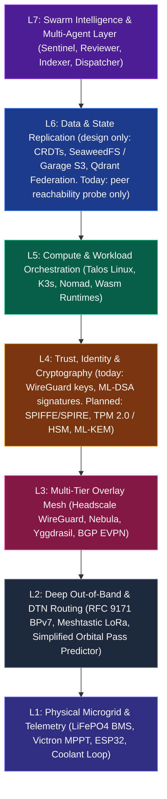
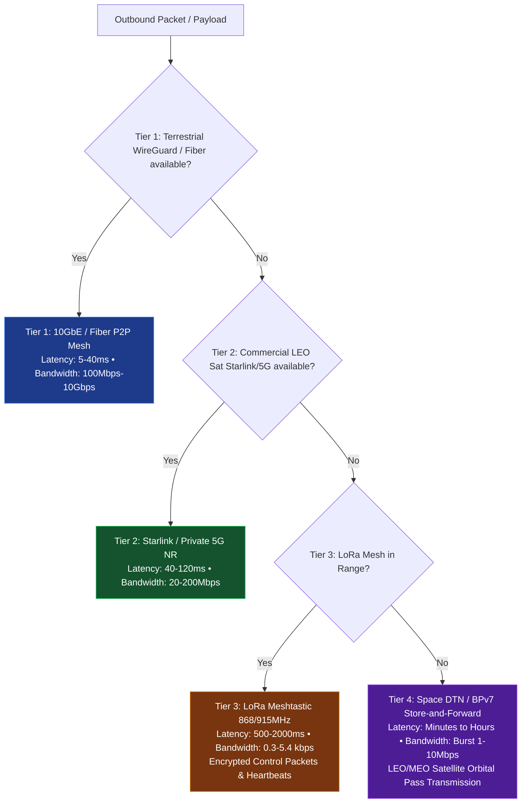
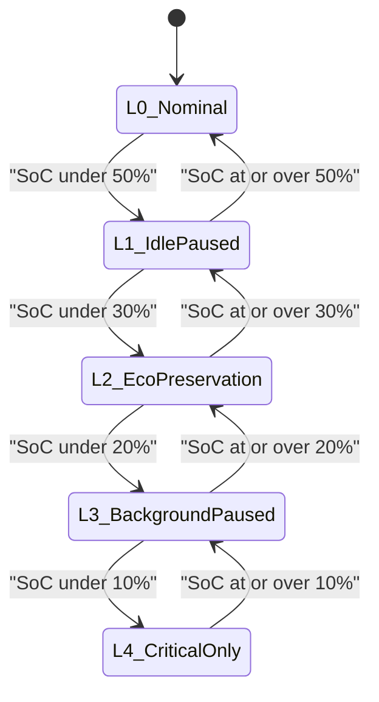
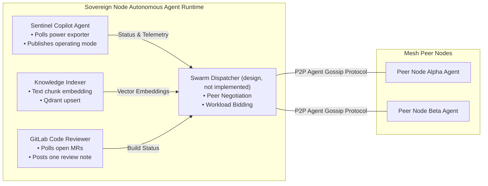
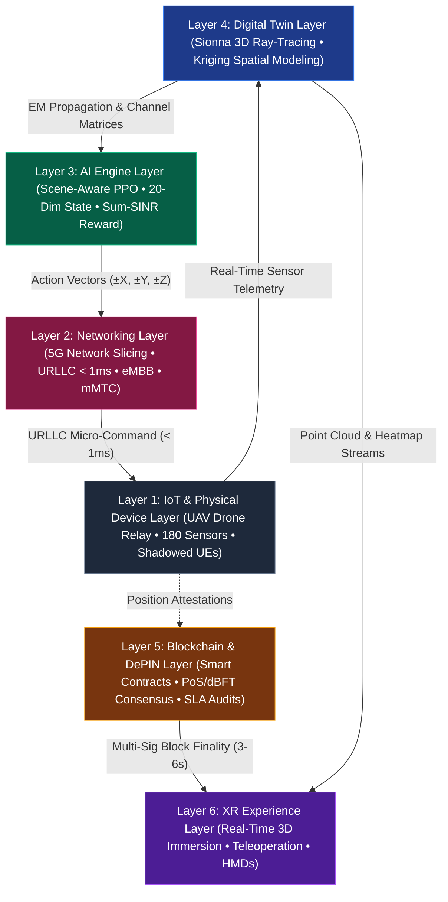

# 🌐 Architecture for a Fully Autonomous Network of Sovereign Mini Datacenters

> **Sovereign Mesh & Autonomous Micro-Datacenter Network Architecture**  
> Complete design specification for decentralized, off-grid, energy-aware, self-healing compute clusters.  
> **Author & Lead Architect**: [Ilias Chrysovergis](https://iliachry.gr) · [Metatopia Studio](https://metatopia.gr) · License: MIT · © 2026

---

## 1. Executive Summary & Vision

A **Fully Autonomous Network of Sovereign Mini Datacenters (Autonomous Sovereign Mesh)** is a decentralized, self-governing compute fabric designed to operate seamlessly across catastrophic infrastructure failures, long-term power grid blackouts, geopolitical isolation, and extreme network partitions.

Unlike traditional cloud architectures that depend on centralized control planes (e.g. AWS, Azure, GCP, Cloudflare), **every node in this network is an independently viable sovereign micro-datacenter**. Each unit incorporates its own:
- ☀️ **Solar Micro-Grid & Battery Management System (BMS)**
- ❄️ **Cooling Subsystem** (air-cooled AI nodes, closed liquid loop for the system host)
- 🤖 **Local AI Inference Engine & Multi-Agent Copilots**
- 📡 **Multi-Spectral Communication Transceivers** (Terrestrial Mesh, Starlink/LEO, Sub-GHz LoRa, and Space DTN/BPv7)

> **Status of this document:** this is a target architecture. It describes design intent alongside what the repository ships, and the two are not the same. In the trust and security layer in particular, only the WireGuard overlay (Headscale), HTTPS termination in Traefik, Restic encrypted backups and ML-DSA signatures on wallets and app packages are implemented. SPIFFE/SPIRE, mutual TLS between services, TPM or HSM roots of trust, Secure Boot, decentralized identifiers and post-quantum key exchange on links are **planned and not implemented**. [`COMPLIANCE.md`](COMPLIANCE.md) has the control-by-control status.

```
                                    ┌──────────────────────────────────────┐
                                    │    LEO/MEO SATELLITE CONSTELLATION   │
                                    │    (Orbital DTN / BPv7 Store-Forward)│
                                    └──────┬──────────────────────┬────────┘
                                           │ RFC 9171 Bundles     │ Pass Prediction
                                           ▼                      ▼
┌──────────────────────────────────────────────┐              ┌──────────────────────────────────────────────┐
│       NODE-ALPHA (Sovereign Core)            │              │        NODE-BETA (Edge AI Station)           │
│ ┌──────────────────────────────────────────┐ │              │ ┌──────────────────────────────────────────┐ │
│ │ Power Microgrid: 3.28kW PV + 10.24kWh    │ │              │ │ Power Microgrid: 820W PV + 5.12kWh       │ │
│ │ Compute: 2x NVIDIA DGX Spark (GB10)      │ │              │ │ Compute: 1x Jetson Orin AGX (275 TOPS)   │ │
│ │ Storage: 2x4TB NVMe RAID-1 (4TB usable)  │ │              │ │ Storage: 4TB NVMe RAID-1                 │ │
│ │ Local AI: Ollama + Qdrant RAG + Sentinel │ │              │ │ Local AI: Ollama + Local Agents          │ │
│ └──────────────────────────────────────────┘ │              │ └──────────────────────────────────────────┘ │
│  Transceivers: 10GbE SFP+ | LoRa | Starlink  │              │  Transceivers: 2.5GbE | LoRa | Direct LEO    │
└──────┬────────────────────────────────┬──────┘              └──────┬────────────────────────────────┬──────┘
       │                                │                            │                                │
       │ WireGuard / Nebula P2P Overlay │                            │ WireGuard / Nebula P2P Overlay │
       │ (100.64.0.0/16 High-Bandwidth) │                            │ (100.64.0.0/16 High-Bandwidth) │
       ├────────────────────────────────┼────────────────────────────┤                                │
       │                                │                                                             │
       │                                │ LoRa 868/915MHz Out-of-Band Emergency Control Plane         │
       │                                └─────────────────────────────────────────────────────────────┘
       ▼
┌──────────────────────────────────────────────┐
│       NODE-GAMMA (Island Off-Grid)           │
│ ┌──────────────────────────────────────────┐ │
│ │ Power Microgrid: 3.28kW PV + 20.48kWh    │ │
│ │ Compute: 4x Jetson Orin Nodes (1100 TOPS)│ │
│ │ Storage: 16TB Encrypted Ceph/Garage S3   │ │
│ │ Autonomous Agents: Master Dispatcher     │ │
│ └──────────────────────────────────────────┘ │
│  Transceivers: LoRa Gateway | Iridium SBD   │
└──────────────────────────────────────────────┘
```

---

## 2. Layered Autonomous Stack (7-Layer Protocol Model)



| Layer | Subsystem | Sovereign Technology Stack | Primary Function |
| :--- | :--- | :--- | :--- |
| **L7: Swarm Intelligence** | Multi-Agent Coordination | Sentinel mode publisher, GitLab Reviewer and Indexer (implemented); swarm dispatcher / disaster broker (design only) | Target: workload negotiation, energy-aware job dispatch, model weight sharing. Today: one node-local operating mode that the indexer and the enterprise manager honour. |
| **L6: Data & Consensus** | Distributed State Fabric | Design only: CRDTs, SeaweedFS / Garage S3, Qdrant federation, Raft state quorum. Implemented: `mesh_sync.py`, which only probes whether each peer's exporter is reachable, an in-process Raft simulator (`smdc mesh consensus`) and single-node Restic backups | Target: masterless data sync, vector index federation, replicated snapshots. Today: nothing is replicated or synchronised between nodes. |
| **L5: Compute & Workloads** | Sovereign Orchestration | Talos Linux + K3s / Nomad / Docker Engine, WebAssembly (Wasm) | Dynamic container scheduling, AI batch pipelines, emergency load shedding. |
| **L4: Trust & Identity** | Identity & PKI | Implemented: WireGuard node keys (Headscale), Ed25519 and ML-DSA wallet and package signatures. Planned: SPIFFE/SPIRE, TPM 2.0 / HSM attestation, ML-KEM key exchange | Target: cryptographic machine identity, mutual TLS (mTLS), hardware trust roots. Today: node keys on the VPN overlay and signed packages; no mTLS and no hardware trust root. |
| **L3: Network Fabric** | Multi-Tier Overlay Mesh | Headscale (WireGuard), Nebula, Yggdrasil, BGP EVPN | Seamless P2P flat mesh routing across dynamic NATs, firewalls, and air-gaps. |
| **L2: Deep Out-of-Band** | Emergency Comms & DTN | RFC 9171 DTN/BPv7, Meshtastic LoRa, Starlink, simplified circular-orbit pass predictor (not SGP4) | Asynchronous orbital store-and-forward, low-baud heartbeat broadcast. |
| **L1: Energy & Physical** | Microgrid & Telemetry | LiFePO4 BMS, Victron MPPT (VE.Direct/RS485), ESP32, Host Liquid Loop & Exhaust Fans | Solar harvesting, autonomous thermal regulation, brownout cold-recovery. |

---

## 3. Multi-Tier Communication Fabric

When operating a distributed network of sovereign nodes, network connectivity is treated as dynamic and probabilistic. The network implements **four autonomous communication tiers** with automatic, seamless failover and failback:



### Communication Tier Details

1. **Tier 1: High-Bandwidth Terrestrial WireGuard Mesh (Headscale implemented; Nebula is an alternative, not shipped)**
   * **Underlay**: Fiber broadband, point-to-point 60GHz / 5GHz wireless bridges, local LANs.
   * **Overlay**: WireGuard encrypted peer-to-peer tunnels managed by a federated control plane.
   * **Payloads**: Real-time multi-node AI model updates, Git repository synchronization, streaming telemetry, live database transactions.

2. **Tier 2: Starlink / Direct-to-Cell / Private 5G NR**
   * **Trigger**: Automated failover upon loss of terrestrial pings (>3 lost heartbeats).
   * **Action**: Multi-WAN router auto-routes encrypted mesh overlay traffic over satellite/cellular interfaces.

3. **Tier 3: LoRa Meshtastic Out-of-Band Emergency Control Plane (Sub-GHz)**
   * **Physical**: Optional USB/serial Semtech SX1262 LoRa Meshtastic radio (outside the base BOM; `software/mesh/lora/meshtastic_gateway.py` provides the JSON packet codec and Space DTN fallback forwarding, while serial/TCP radio attach is not implemented).
   * **Protocol**: Meshtastic packet format using the channel encryption configured on the radio (AES-256-CTR for pre-shared channel keys).
   * **Capacity**: Outbound alert framing and DTN fallback spooling implemented; live radio heartbeat broadcast and remote kill/wake signals are design targets, not implemented.

4. **Tier 4: Space DTN / BPv7 Store-and-Forward (RFC 9171)**
   * **Trigger**: Complete terrestrial and line-of-sight isolation (Grid Down / Electromagnetic disruption).
   * **Mechanism**: The node's `smdc.space` orbital propagator predicts LEO/MEO satellite relay passes with a simplified circular-orbit model (not SGP4; pass times are approximate). Unencrypted, SHA-256 digest-verified bundles are queued in persistent NVMe storage and burst-transmitted during simulated Acquisition of Signal (AOS) to Loss of Signal (LOS) windows (encrypt sensitive payloads before submission).

---

## 4. Energy-Directed Distributed Workload Scheduling (Green-Compute Routing)

Workload execution across the sovereign network is continuously steered by **real-time solar irradiance and battery State-of-Charge (SoC)**. Workloads dynamically gravitate toward nodes with energy surplus.

### Compute Routing Equation

$$
S_i = \omega_1 \cdot \mathrm{SoC}_i + \omega_2 \cdot \frac{P_{\mathrm{solar}, i}}{P_{\mathrm{max}}} + \omega_3 \cdot (1 - U_{\mathrm{gpu}, i}) - \omega_4 \cdot \hat{T}_{\mathrm{coolant}, i}
$$

Where:
- $\mathrm{SoC}_i \in [0, 1]$ is the battery State of Charge.
- $P_{\mathrm{solar}, i} / P_{\mathrm{max}}$ is the normalized solar power harvesting rate.
- $U_{\mathrm{gpu}, i} \in [0, 1]$ is the active compute utilization.
- $\hat{T}_{\mathrm{coolant}, i} \in [0, 1]$ is the coolant loop temperature normalized against maximum safe operating temperature.
- $\omega_1, \omega_2, \omega_3, \omega_4$ are dynamically weighted scheduling coefficients.

```
                ┌────────────────────────────────────────────────────────┐
                │          DISTRIBUTED ENERGY AWARENESS MATRIX           │
                └───────────────────────────┬────────────────────────────┘
                                            │
               ┌────────────────────────────┴────────────────────────────┐
               ▼                                                         ▼
    ┌──────────────────────┐                                  ┌──────────────────────┐
    │     NODE ALPHA       │                                  │      NODE BETA       │
    │ ☀️ Solar: 1,450 W    │                                  │ ☁️ Solar: 80 W       │
    │ 🔋 SoC: 96% (Surplus)│                                  │ 🔋 SoC: 28% (Warning)│
    │ 🌡️ Coolant: 27°C     │                                  │ 🌡️ Coolant: 34°C     │
    └──────────┬───────────┘                                  └──────────┬───────────┘
               │                                                         │
               │ ◄────────── MIGRATES AI INFERENCE & RAG JOBS ───────────┤
               │             (Via Autonomous Swarm Dispatcher)           │
               ▼                                                         ▼
    ┌──────────────────────┐                                  ┌──────────────────────┐
    │ High-Power AI Batch  │                                  │ Low-Power Standby    │
    │ Vector Re-indexing   │                                  │ LoRa Heartbeat Only  │
    │ Model Fine-Tuning    │                                  │ Load Shedding L2     │
    └──────────────────────┘                                  └──────────────────────┘
```

### Autonomous Dynamic Load-Shedding Levels

One policy maps battery state of charge (SoC) to a shedding level from 0 to 4. The thresholds are `SovereignConfig.shedding_l1_soc` to `shedding_l4_soc` (environment variables `SHEDDING_L1_SOC` to `SHEDDING_L4_SOC`, defaults 50, 30, 20 and 10); every component below reads the same variables with the same defaults.



What the code in this repository does at each level:

<!-- shedding-levels:begin (tests/test_regress_round4_shedding.py compares this table with the code defaults) -->
| Shedding level | Battery SoC | Sentinel mode | App tiers the `EnterpriseManager` marks paused | Other components |
| :---: | :--- | :--- | :--- | :--- |
| **0** | at or above 50 % | `NORMAL` (`SOLAR_SURPLUS_COMPUTE` while PV power is above 1000 W and SoC above 75 %) | none | none |
| **1** | below 50 % | `NORMAL` | `L4_IDLE` | none |
| **2** | below 30 % | `ECO_PRESERVATION` | `L3_DEFERRABLE`, `L4_IDLE` | The knowledge indexer defers its batch work while the mode file says `ECO_PRESERVATION`. |
| **3** | below 20 % | `ECO_PRESERVATION` | `L2_BACKGROUND`, `L3_DEFERRABLE`, `L4_IDLE` | The power exporter sets `sovereign_load_shedding_active` to 1; `load_shedder.sh` raises its low-battery cause. |
| **4** | below 10 % | `ECO_PRESERVATION` | `L1_STANDARD`, `L2_BACKGROUND`, `L3_DEFERRABLE`, `L4_IDLE` | Same as level 3. |
<!-- shedding-levels:end -->

* **Sentinel copilot** (`sentinel_copilot.py`): computes the level from the exporter's SoC, writes the mode to the shared mode file and publishes `load_shedding.changed` with `mode`, `level` and `battery_soc` on the in-process event bus. The table gives the SoC at which a level is entered; the running sentinel leaves a level only once the SoC is `SHEDDING_HYSTERESIS_SOC` points (default 2) above that level's threshold (capped at 100 %; 12, 22, 32 and 52 % with the defaults), so an SoC hovering at a threshold does not toggle the level on every poll. The thresholds are validated as one policy (numbers within 0–100, L1 > L2 > L3 > L4); on a violation one warning is logged and all four defaults are used. While the SoC is unknown the last mode and level are held.
* **`EnterpriseManager`**: marks tracked applications paused by power tier as in the table, and additionally while a reported SoC is below an application's `power.min_battery_soc`; `L0_CRITICAL` is never paused. An application started while a level is in force is started paused by shedding. It tracks state and publishes events; it does not supervise processes. Details: [`ENTERPRISE_ONBOARDING.md`](ENTERPRISE_ONBOARDING.md), section 3.
* **Power exporter**: `sovereign_load_shedding_active` is 1 from level 3 (SoC below `SHEDDING_L3_SOC`).
* **`software/telemetry/load_shedder.sh`** (host script, one pass per run): raises its low-battery cause from level 3 and considers it over at level 0 (SoC at or above `SHEDDING_L1_SOC`). Its second cause is thermal: coolant above 60 °C, over at or below 55 °C. It only logs unless `LOAD_SHED_ACTION=pause`, in which case it runs `docker pause` / `docker unpause` on one container; while the container's state cannot be determined (`docker inspect` fails) it keeps its pause marker and retries on the next run.

> **Design targets, not implemented.** The hardware actions originally planned for these levels are not performed by any code in this repository: capping GPU power at level 1, powering down the secondary compute node through a smart PDU or relay at level 2, suspending the primary compute node at level 3 (ESP32 bridge and switch staying on the 12 V rail, LoRa beacons every 10 minutes), and isolating the AC inverters at level 4 with an ESP32 solar wake-up. Nothing throttles a GPU, switches a relay or suspends a node.

---

## 5. Decentralized Storage, Sync & State Replication (Target Design)

> **Planned, not implemented.** No CRDT engine, SeaweedFS / Garage cluster, Qdrant federation or Git bundle exchange exists in this repository, and no state is synchronised between nodes. The mesh daemon (`mesh_sync.py`) only probes whether each peer's telemetry exporter answers over its mesh address and logs the result. Each node runs its own Qdrant and its own Restic backups (point 3 below).

The design goal: data in an autonomous network survives complete network isolation without split-brain corruption.

```
                              ┌───────────────────────────────────┐
                              │     SOVEREIGN STATE HIERARCHY     │
                              └─────────────────┬─────────────────┘
                                                │
         ┌──────────────────────────────┬───────┴──────────────────────┬──────────────────────────────┐
         ▼                              ▼                              ▼                              ▼
┌──────────────────┐          ┌──────────────────┐          ┌──────────────────┐          ┌──────────────────┐
│  GIT EMBEDDED    │          │  OBJECT STORAGE  │          │  VECTOR DATABASE │          │  KEY-VALUE DB    │
│  REPOSITORIES    │          │  (SeaweedFS/S3)  │          │  (Qdrant Engine) │          │  (CRDT Engine)   │
├──────────────────┤          ├──────────────────┤          ├──────────────────┤          ├──────────────────┤
│ Multi-Master P2P │          │ Geo-Replication  │          │ Local Embeddings │          │ Conflict-Free    │
│ Git Bundle Sync  │          │ Content Address  │          │ Vector Shards    │          │ Replicated Types │
│ via WireGuard &  │          │ Erasure Coded    │          │ Peer Nearest-    │          │ Node Configs &   │
│ DTN Satellite    │          │ Deduplicated     │          │ Neighbor Search  │          │ Node Registries  │
└──────────────────┘          └──────────────────┘          └──────────────────┘          └──────────────────┘
```

1. **Object Storage Layer (SeaweedFS / Garage S3)**
   * Masterless distributed S3-compatible cluster with Reed-Solomon Erasure Coding ($N=4, K=2$).
   * Local writes persist to local NVMe immediately; asynchronous synchronization triggers upon mesh link re-establishment.

2. **Semantic Memory & Vector Search (Federated Qdrant)**
   * Local embeddings generated via quantized on-node models (`nomic-embed-text` / `bge-m3`).
   * Collections partitioned by Node IDs with distributed HNSW graph querying across active mesh links.

3. **Encrypted Snapshot Quorum (Restic Engine)**
   * Implemented: scheduled Restic backups, encrypted with a repository password, to one repository (local by default).
   * Planned: replication across $M \ge 3$ sovereign peers, and repository keys held in a TPM or HSM. Neither exists in the repository.

---

## 6. Multi-Agent Swarm Intelligence & Governance

Each sovereign datacenter runs a localized multi-agent loop collaborating with peer agents across the mesh:



What the code in this repository does today (the diagram above is the target design; the dispatcher and the peer gossip protocol do not exist yet):

- **Sentinel Copilot Agent** (`sentinel_copilot.py`): Polls the power exporter's `/metrics` over HTTP every `SENTINEL_POLL_INTERVAL_SECONDS` (default 30). It does not open serial ports, Modbus or 1-Wire devices itself. From battery state of charge and PV power it derives an operating mode (`NORMAL`, `SOLAR_SURPLUS_COMPUTE`, `ECO_PRESERVATION`), writes it to a shared mode file and publishes a `load_shedding.changed` event on the in-process event bus. It throttles no GPU and drives no pump or fan; consumers of the mode act on it (the knowledge indexer defers indexing; an `EnterpriseManager` in the same process marks deferrable apps paused).
- **GitLab Code Reviewer** (`gitlab_reviewer.py`): Polls open merge requests every 60 s and posts one LLM-generated review note per MR revision. It generates no patches and gates no builds.
- **Knowledge Indexer** (`knowledge_indexer.py`): Polls a directory of plain-text files, embeds their chunks via Ollama and upserts them into Qdrant.
- **Technician Notifier** (`technician_notifier.py`): Writes alerts to a local JSONL log and queues them in the DTN spool; its MQTT and LoRa channels are placeholders that report failure.
- **Bootstrap Provisioner** (`bootstrap_provisioner.py`): Read-only start-up checker (hardware inventory, peer probes, Docker/Ollama/Qdrant/Prometheus reachability, DTN spool depth). It starts no service and synchronises no state.
- **Swarm Dispatcher Agent** (design only, not implemented): would take part in a compute-bidding marketplace, shifting heavy tasks to nodes with >80% battery SoC and excess solar.
- **Space Link Scheduler** (partly implemented): contact windows are computed with the simplified circular-orbit propagator (not SGP4) and bundles are spooled by the DTN router; nothing schedules burst transmission against a real radio.

---

## 7. Security, Identity & Cryptographic Roots (Target Design)

The aim is security that does not depend on external Certificate Authorities or single points of failure.

> **Planned, not implemented.** The diagram and the four points below are the target design. None of the hardware root of trust, decentralized identifiers, SPIFFE/SPIRE attestation, mutual TLS between services, CrowdSec decision sharing or post-quantum key exchange exists in this repository. What exists today: a Headscale-managed WireGuard overlay, HTTPS termination with Let's Encrypt certificates in Traefik (an external certificate authority), a CrowdSec engine in detection-only mode on each node, LUKS2 keyed to the node UUID on the Talos path, and ML-DSA / ML-KEM as a pure-Python library used for wallet and package signatures. See [`COMPLIANCE.md`](COMPLIANCE.md).

```
                    ┌────────────────────────────────────────────────────────┐
                    │               HARDWARE ROOT OF TRUST                   │
                    │               (TPM 2.0 / YubiKey HSM)                  │
                    └───────────────────────────┬────────────────────────────┘
                                                │
                     ┌──────────────────────────┴──────────────────────────┐
                     ▼                                                     ▼
    ┌──────────────────────────────────┐                  ┌──────────────────────────────────┐
    │     DECENTRALIZED ID (DID)       │                  │     SPIFFE / SPIRE WORKLOAD      │
    │   did:sovereign:node-alpha-01    │                  │           ATTESTATION            │
    └──────────────────┬───────────────┘                  └──────────────────┬───────────────┘
                       │                                                     │
                       ▼                                                     ▼
    ┌──────────────────────────────────┐                  ┌──────────────────────────────────┐
    │ Post-Quantum Cryptography (PQC)  │                  │ Mutual TLS (mTLS) Inter-Service  │
    │ Kyber-1024 Key Encapsulation     │                  │ Short-lived x509 SVIDs           │
    │ Dilithium-5 Signatures           │                  │ Hardware Attested Identity       │
    └──────────────────────────────────┘                  └──────────────────────────────────┘
```

1. **Hardware-Attested Node Identity (planned)**: cryptographic identity rooted in a discrete TPM 2.0 chip, with boot integrity verified by UEFI Secure Boot and the Talos Linux immutable image.
2. **Workload Attestation with SPIFFE/SPIRE (planned)**: services would receive dynamic, short-lived X.509 SVID certificates based on runtime cryptographic attestation of container hashes, namespaces, and node signatures.
3. **Mesh Threat Defense (planned)**: attack signatures detected on one node would be shared across the mesh over WireGuard and LoRa. Today each node's CrowdSec engine works alone and only detects.
4. **Post-Quantum Cryptography (planned for links)**: inter-node tunnels would use hybrid post-quantum key encapsulation (X25519 + ML-KEM-1024). Today the tunnels use WireGuard's standard handshake; ML-KEM exists only as a library and self-test.

---

## 8. Disaster Recovery, Black-Start & Self-Healing Protocol (Target Design)

> **Target design, not implemented.** Autonomous relay switching and BMS-gated cold-start recovery are target hardware architecture behaviours, not implemented in this repository. As stated in Section 4 ("Nothing throttles a GPU, switches a relay or suspends a node") and `firmware/README.md`, the shipped ESP32 firmware is read-only telemetry (VE.Direct UART + DS18B20 1-Wire) and drives only `STATUS_LED_PIN` (no BMS cell reads, relay outputs, or SoC gates). Under the target architecture, recovery follows this **Cold-Start Sequence**:

```mermaid
sequenceDiagram
    autonumber
    participant Sun as "☀️ Solar Array (MPPT)"
    participant BMS as "🔋 LiFePO4 BMS"
    participant ESP as "🔌 ESP32 Micro-Controller"
    participant PDU as "⚡ DC-DC / AC PDU"
    participant Compute as "🖥️ Main Compute (DGX Spark / x86 Host)"
    participant Mesh as "🌐 Sovereign Mesh Peers"

    Sun->>BMS: Solar irradiance restores voltage (above 48V)
    BMS->>ESP: BMS activates 5V Auxiliary Rail (target design)
    ESP->>ESP: Boot ESP32 firmware, read cell voltages and temperatures (target design, not implemented)
    Note over ESP: Wait until battery SoC above 25% (Safe Hysteresis; target design, not implemented)
    ESP->>PDU: Trigger Relay Pin (Engage Main Inverter & 12V/19V Rails; target design, not implemented)
    PDU->>Compute: Cold Boot Compute Nodes (Wake-on-Power; target design, not implemented)
    Compute->>Compute: Load Talos Linux / K3s immutable OS
    Compute->>Compute: Initialize WireGuard & Headscale client
    Compute->>Mesh: Send WireGuard & LoRa NODE_ONLINE_RECOVERED Beacon (target design, not implemented)
    Mesh-->>Compute: Replay missed state logs & DTN bundles (target design, not implemented)
    Note over Compute: Node operational (peers are only probed for reachability today)
```

---

## 9. Comprehensive Node Hardware & Topology Reference

| Node Archetype | Hardware Platform | Power Subsystem | Primary Capabilities | Typical Location |
| :--- | :--- | :--- | :--- | :--- |
| **Core Nexus** | 2x NVIDIA DGX Spark (reference build), or Dual AMD EPYC + 4x RTX 4090 | 10.24–20.48 kWh LiFePO4 + 3.28 kW Solar | Heavy LLM fine-tuning, Master Headscale control plane, S3 Master. | Fixed bunker, research lab, regional HQ |
| **Edge Station** | 1x NVIDIA Jetson AGX Orin (lower-power alternative) + 1x Supermicro Mini-ITX | 5.12 kWh LiFePO4 + 820W Solar | Local AI inference, GitLab CI/CD, Nextcloud file sync, Starlink uplink. | Remote outpost, mobile vehicle, container |
| **Off-Grid Island** | 2x Low-power ARM64 nodes + SX1262 LoRa + Iridium | 2.56 kWh LiFePO4 + 410W Solar | Mesh relay, LoRa packet gateway, environmental sensing, DTN pass station. | Mountain peak, island, deep wilderness |

---

## 10. Implementation Roadmap

```
Phase 1: Multi-Node Overlay & Workload-Identity PKI
  ├── Extend `software/vpn/` with automated Headscale federated join
  ├── Integrate SPIRE/SPIFFE workload attestation into `kubernetes/helm/`
  └── Implement DID node registration in `src/sovereign_dc/mesh/`

Phase 2: Energy-Aware Workload Dispatcher
  ├── Integrate Victron/BMS telemetry into Kubernetes custom metrics API (KEDA)
  ├── Build `smdc mesh schedule` algorithm for solar-following job migration
  └── Add LoRa emergency shed/wake signal handlers to `firmware/`

Phase 3: Decentralized Storage & CRDT State Sync
  ├── Deploy SeaweedFS / Garage S3 multi-cluster geo-replication
  ├── Implement distributed vector search aggregation in `smdc agent`
  └── Add async Git bundle exchange over DTN (`smdc space sync`)

Phase 4: Autonomous Swarm Multi-Agent Governance
  ├── Create P2P gossip broker for Sentinel agents
  ├── Connect CrowdSec mesh threat intelligence across all nodes
  └── Launch automated orbital DTN contact scheduling with automated ground station tracking
```

---

## 11. 6-Layer Metaverse Framework for Wireless Systems Management (IEEE IoT Mag 2026)

Based on the published IEEE Internet of Things Magazine theoretical framework (*"A Metaverse Framework for Wireless Systems Management"*, Sept 2026; Ilias Chrysovergis, Alexandros-Apostolos A. Boulogeorgos, Theodoros A. Tsiftsis, Dusit Niyato), the sovereign stack integrates a closed-loop cyber-physical optimization architecture:



### Key Analytical Specifications
1. **Electromagnetic Ray-Tracing**: 3GPP UMi model at 3.5 GHz ($23\text{ dBm}$ TX, $+8\text{ dBi}$ gain), up to 5 reflection orders, urban building LoS obstruction checking, and spatial Kriging interpolation.
2. **Scene-Aware Reinforcement Learning (SA-PPO)**: 3-layer Actor-Critic network ([256, 128, 64]) with 20-dim state vector, with the paper reporting a $+79.6\%$ capacity boost on disadvantaged receiver Rx1 (not reproduced by this repository's simplified simulator) compared to conventional model-driven policies (MD-PPO).
3. **5G Network Slicing & SDN**: Mathematical bandwidth isolation $T_{\mathrm{tx}} = \frac{D \cdot 8}{B_{\mathrm{slice}}} \cdot 1000\text{ ms}$, ensuring $< 1\text{ ms}$ URLLC flight execution.
4. **DePIN PoS/dBFT Consensus**: $\lfloor 2N/3 \rfloor + 1$ multi-signature validation, enforcing $-15\text{ dB}$ minimum SINR rejection thresholds.
5. **Algorithm 1 Multi-Phase Execution Pipeline**:
   - **Phase 1 (Parallel Collection)**: Concurrently gathers IoT telemetry and evaluates Sionna ray-tracing propagation.
   - **Phase 2 (Critical Path $<6\text{ ms}$)**: AI policy inference $\to$ URLLC dispatch $\to$ UAV actuator response.
   - **Phase 3 (Asynchronous Finalization)**: Multi-signature validator voting, smart contract execution, and ledger finality ($3\text{--}6\text{ s}$).
