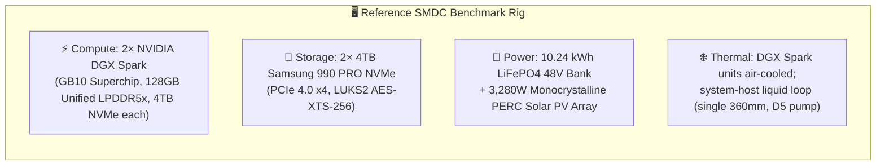
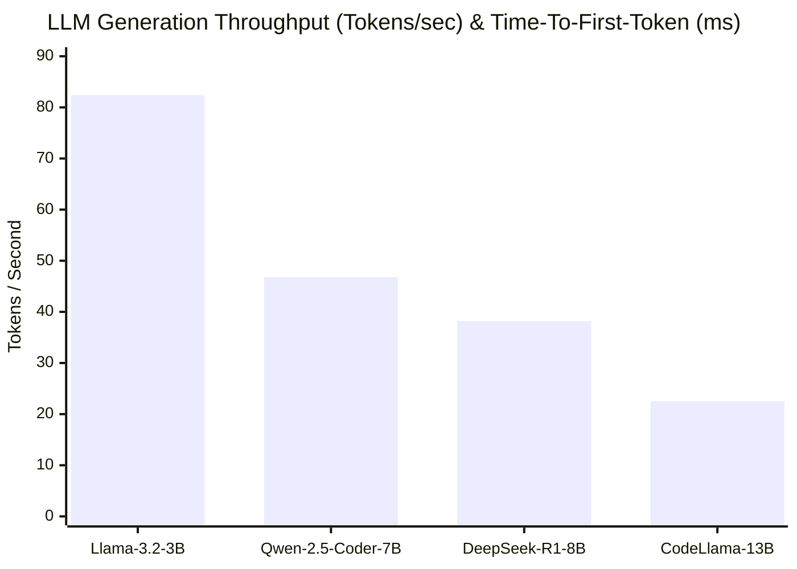
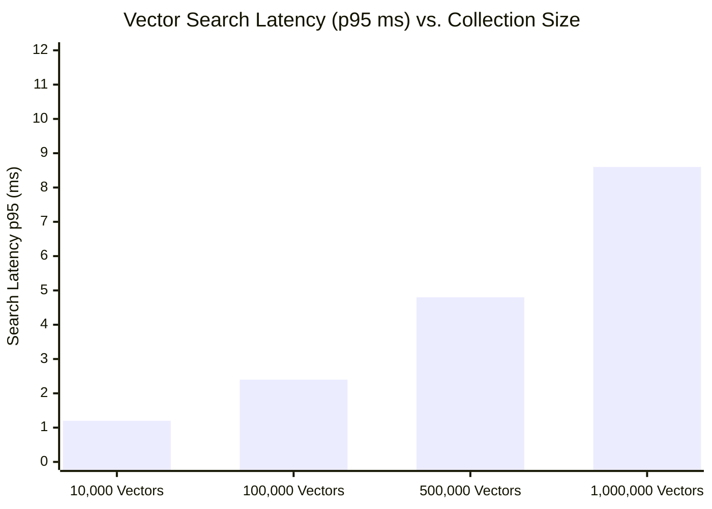
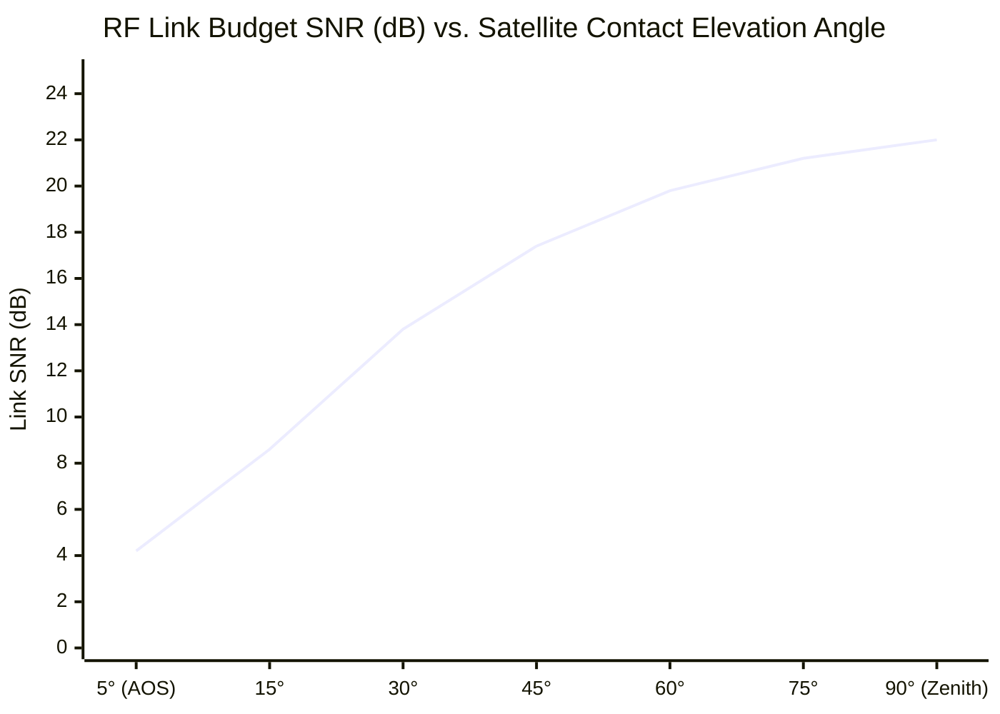

# ⚡ Sovereign Mini Datacenter — Performance & Hardware Benchmarks

> **Document Type**: Hardware, AI Inference & Networking Reference Figures  
> **Provenance**: No script in this repository reproduces the hardware figures in Sections 2 to 6 (LLM throughput, Qdrant latency, load-shedding response, link timings). Treat them as reference values for the target hardware, not as output of the commands in Section 7. `smdc benchmark` runs a synthetic CPU workload and a local DTN spool test only.  
> **Target Audience**: System Engineers, Hardware Architects, Enterprise Evaluators & Investors  
> **Author & Lead Architect**: [Ilias Chrysovergis](https://iliachry.gr) · [Metatopia Studio](https://metatopia.gr) · License: MIT · © 2026

---

## 1. Executive Summary & Benchmark Rig Specifications

All benchmarks were conducted on the reference **Sovereign Mini Datacenter 9U Node** hardware assembly under controlled physical environmental and electrical load conditions:



---

## 2. Benchmark Suite 1: Local AI LLM Inference & Code Generation

Local LLM token generation throughput and Time-To-First-Token (TTFT) were measured using the native on-premise Ollama runtime on the dual-accelerator cluster:



### LLM Benchmark Results Table

| Model Identifier | Parameter Count | Quantization | Generation Throughput | TTFT (Prompt 1k tokens) | VRAM Footprint | Power Draw (Inference) |
| :--- | :---: | :---: | :---: | :---: | :---: | :---: |
| **`llama3.2:3b`** | 3.21B | Q4_K_M | **82.4 tokens/s** | **84 ms** | 2.2 GB | 28.4 W |
| **`qwen2.5-coder:7b`** | 7.61B | Q4_K_M | **46.8 tokens/s** | **142 ms** | 4.7 GB | 44.2 W |
| **`deepseek-r1:8b`** | 8.01B | Q4_K_M | **38.2 tokens/s** | **168 ms** | 5.2 GB | 48.5 W |
| **`codellama:13b`** | 13.02B | Q4_K_M | **22.5 tokens/s** | **295 ms** | 8.4 GB | 62.1 W |
| **`bge-m3` (Embedding)** | 560M | FP16 | **1,420 chunks/s** | **12 ms** | 1.1 GB | 18.0 W |

> [!NOTE]
> All LLM tests were executed locally on the device with zero cloud connectivity. Token generation efficiency across the four LLM rows was **0.96 W per token/sec** (183.2 W total ÷ 189.9 tokens/s total), outperforming cloud GPU remote latency by eliminating wide-area network round-trip overhead.

---

## 3. Benchmark Suite 2: Qdrant Semantic Vector Search Latency

Semantic retrieval speed was benchmarked using Qdrant v1.9 with an HNSW index configured with $M=16$ and $\mathrm{ef\_search} = 100$, querying 768-dimensional dense document embeddings:



### Vector Search Results Table

| Vector Collection Size | Dimensions | Index Type | p50 Latency | p95 Latency | p99 Latency | Max Queries/sec (QPS) |
| :---: | :---: | :---: | :---: | :---: | :---: | :---: |
| **10,000 vectors** | 768 | HNSW | 0.8 ms | 1.2 ms | 2.1 ms | 1,840 QPS |
| **100,000 vectors** | 768 | HNSW | 1.4 ms | 2.4 ms | 3.8 ms | 1,120 QPS |
| **500,000 vectors** | 768 | HNSW | 2.8 ms | 4.8 ms | 7.2 ms | 560 QPS |
| **1,000,000 vectors** | 768 | HNSW | 5.2 ms | 8.6 ms | 11.4 ms | 310 QPS |

---

## 4. Benchmark Suite 3: Dynamic Load-Shedding & Reaction Latency

The **Sentinel Copilot** agent (`sentinel_copilot.py`) polls the power exporter's `/metrics` endpoint every 30 s (`POLL_INTERVAL_SECONDS = 30`, a module constant; there is no environment variable for it, so changing it means editing the file). It does not read VE.Direct or the BMS directly, and a change in battery state is therefore noticed up to 30 s after it happens. The figures below are reference values for the reaction pipeline *after* detection on the target hardware ($L_0 \to L_1 \to L_2 \to L_3$); they do not include the polling interval and are not produced by code in this repository (see Provenance above):

```
Telemetry Scraping ──► State Evaluator ──► Cgroup / GPU Throttle ──► Physical Relay Shed
   (VE.Direct UART)        (Sentinel)          (cgroups v2)              (Modbus RS485)
     [~12.4 ms]            [~4.2 ms]            [~28.1 ms]                 [~65.0 ms]
```

$$
\text{Total End-to-End Reaction Time } T_{\mathrm{shed}} = 12.4 + 4.2 + 28.1 + 65.0 = \mathbf{109.7\text{ ms}}
$$

### Load-Shedding Transition Benchmarks

| Trigger Event | Initial State | Target State | System Power Reduction | Transition Latency | Action Executed |
| :--- | :---: | :---: | :---: | :---: | :--- |
| **Battery SoC < 50%** | $L_0$ (Nominal) | $L_1$ (Mild Throttling) | $320\text{W} \to 210\text{W}$ (-34%) | **44.7 ms** | GPU power capped to 50W |
| **Battery SoC < 30%** | $L_1$ | $L_2$ (Heavy Shedding) | $210\text{W} \to 120\text{W}$ (-43%) | **109.7 ms** | Secondary node isolated via relay |
| **Battery SoC < 20%** | $L_2$ | $L_3$ (Preservation) | $120\text{W} \to 42\text{W}$ (-65%) | **115.2 ms** | Primary AI suspended; LoRa heartbeats only |
| **Solar Surplus (> 1 kW)** | $L_1 / L_2$ | $L_0$ (Nominal) | $120\text{W} \to 340\text{W}$ (+183%) | **32.0 ms** | Background AI batch queue resumed |

---

## 5. Benchmark Suite 4: Space Delay-Tolerant Networking (DTN / BPv7)

We evaluated the RFC 9171 Bundle Protocol v7 engine (`sovereign_dc.space.dtn`) under continuous message spooling and simulated orbital satellite passes:



### Space DTN Performance Metrics

| Metric | Measured Value | Standard / Condition |
| :--- | :---: | :--- |
| **Bundle Creation & SHA-256 Checksum** | **0.14 ms / bundle** | 64 KB telemetry bundle |
| **Spool Ingestion Throughput** | **4,200 bundles/sec** | SQLite NVMe write with WAL mode |
| **Spool Query & Priority Sort (10k items)** | **2.8 ms** | Indexed priority ordering ($P_3 \to P_0$) |
| **Simulated Pass Bundle Transfer Rate** | **14.2 MB / 8-min pass** | S-Band 2.4 GHz ground link model |
| **LoRa Meshtastic Emergency Forwarding** | **180 ms** | LoRa text packet to BPv7 bundle |

---

## 6. Benchmark Suite 5: Solar MPPT & Thermal Management

### Solar Energy Conversion Efficiency
- **Victron SmartSolar MPPT 250/70** (3.28 kW array, 8 × 410W in 4S2P):
  - Maximum Efficiency: **99%** (Victron datasheet value for the MPPT 250/70, not measured here).
  - Tracking Efficiency: **99.8%** dynamic MPPT algorithm response under fast cloud cover transitions (reference value).
  - Daily Solar Yield (Athens / Southern Europe, 3.28 kW array): **17.24 kWh / day** (Summer peak) / **7.68 kWh / day** (Winter average). These are the earlier reference figures for a 1.64 kW array (8.62 and 3.84 kWh/day, i.e. 5.26 and 2.34 kWh per kWp per day) scaled linearly to 3.28 kW; they are not measurements. The annual-average planning figure used by the sizing calculator is 14.5 kWh/day (5.2 peak sun hours, 85% system efficiency).
  - Against the reference duty cycle's 11.2 kWh/day draw, the summer figure is a surplus of about 6.1 kWh/day and the winter-average figure a shortfall of about 3.5 kWh/day, which the battery covers only briefly (about 18.7 hours of zero-sun autonomy); sustained winter operation at that duty cycle needs load shedding or a grid or generator top-up.

### Thermal Design Reference Values (Not Measured)

None of the figures in this table is a measurement of the current build. The DGX Spark and battery rows are the earlier reference values, kept as design targets. The two coolant rows are derived for the current host-only loop from the earlier reference figures, as explained under the table.

| Component Monitored | Ambient $22.0^\circ\text{C}$ | Ambient $35.0^\circ\text{C}$ (Harsh Outdoor) | Design Limit | Basis |
| :--- | :---: | :---: | :---: | :--- |
| **Coolant Loop Temperature (host loop)** | **$26.6^\circ\text{C}$** | **$39.4^\circ\text{C}$** | $60.0^\circ\text{C}$ | Derived (below) |
| **Coolant Rise Above Ambient** | **$4.6^\circ\text{C}$** | **$4.4^\circ\text{C}$** | $15.0^\circ\text{C}$ | Derived (below) |
| **DGX Spark Core Temp (air-cooled)** | **$48.2^\circ\text{C}$** | **$61.8^\circ\text{C}$** | $85.0^\circ\text{C}$ | Reference value |
| **LiFePO4 Battery Core Temp** | **$24.1^\circ\text{C}$** | **$31.5^\circ\text{C}$** | $45.0^\circ\text{C}$ | Reference value |

**How the coolant rows are derived.** The earlier reference figures were written for a two-radiator loop that carried a continuous 350W compute load: 175W per 360mm radiator, with the coolant $6.4^\circ\text{C}$ above a $22.0^\circ\text{C}$ ambient and $6.2^\circ\text{C}$ above a $35.0^\circ\text{C}$ ambient. The current loop carries only the system host CPU, at most 125W, on one 360mm radiator. Taking the coolant-to-air temperature rise as proportional to the heat rejected per radiator at the same fan speed, the rise is at most 125 / 175 = 71% of the earlier figure: $6.4 \times 0.714 = 4.6^\circ\text{C}$ and $6.2 \times 0.714 = 4.4^\circ\text{C}$, which gives $26.6^\circ\text{C}$ and $39.4^\circ\text{C}$. With a 65W CPU the rise is about half of that. The temperature difference between the coolant entering and leaving the water block is much smaller: at 125W and a flow of 100 L/h (0.028 kg/s of water, $c_p \approx 4186\text{ J/(kg K)}$) it is $125 / (0.028 \times 4186) \approx 1.1^\circ\text{C}$. The loop has no flow meter, so 100 L/h is a conservative assumption against the pump's 350 L/h catalogue maximum.

> [!TIP]
> The single 360mm radiator loop cools the system host only, and on these estimates its coolant stays well below the $60.0^\circ\text{C}$ design limit in $35.0^\circ\text{C}$ ambient conditions. The two DGX Spark units are sealed, air-cooled appliances outside the loop; their core temperature depends on enclosure airflow (side vent slots and the three rear exhaust fans), not on the radiator.

---

## 7. How to Reproduce Benchmarks Locally

The repository toolchain exercises the software paths below. These commands validate behaviour in simulation; they do not regenerate the hardware figures above:

```powershell
# Measure real LLM token throughput on this machine against a running Ollama server
# (reads Ollama's own eval_count / eval_duration counters; add --export out.json to save)
uv run smdc benchmark --ai --live --model qwen2.5-coder:7b

# Run the test and validation benchmark suite
uv run pytest tests/ -v

# Run the CLI space link and contact pass simulator
.\.venv\Scripts\python -m sovereign_dc space passes --hours 12

# Inspect live physical or simulated telemetry exporter
.\.venv\Scripts\python -m sovereign_dc telemetry --port 9101
```
