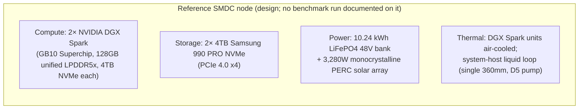

# ⚡ Sovereign Mini Datacenter — Benchmarks: Measured Results and Design Targets

> **Document Type**: Measured software benchmarks, vendor figures and design targets
> **Target Audience**: System Engineers, Hardware Architects, Enterprise Evaluators & Investors
> **Author & Lead Architect**: [Ilias Chrysovergis](https://iliachry.gr) · [Metatopia Studio](https://metatopia.gr) · License: MIT · © 2026

---

## 1. How to Read This Document

**No benchmark run on the reference hardware (two NVIDIA DGX Spark units in the 9U enclosure) is documented in this repository.** Every measured number below was taken on a development machine and says so. Each table carries one of these labels:

| Label | Meaning |
| :--- | :--- |
| **MEASURED** | Output of a command in this repository, with the exact command, the machine and the date. |
| **VENDOR FIGURE** | A number from a manufacturer's datasheet, with the link. Not verified here. |
| **PLANNING ESTIMATE** | A calculated figure, with the inputs stated. |
| **DESIGN TARGET** | What the design aims for. Not measured and, where stated, not implemented. |

Earlier versions of this document listed LLM throughput, Qdrant latency and space-link figures for the DGX Spark rig without a documented run behind them. Those tables have been removed; the sections below say what replaced them and how to produce real numbers.

**Measurement machine** for every MEASURED table: Mac mini, Apple M4, 16 GB unified memory, macOS 27.2, Python 3.12.15, measured on 2026-11-14.



---

## 2. Local LLM Inference — MEASURED (development machine only)

| Model | Quantization | Generation throughput | Tokens generated | Run |
| :--- | :---: | :---: | :---: | :--- |
| `qwen2.5-coder:7b` | Q4_K_M | **19.1 tokens/s** | 104 in 5.45 s | 1 (model load 8.14 s before the first token) |
| `qwen2.5-coder:7b` | Q4_K_M | **19.5 tokens/s** | 104 in 5.32 s | 2 (model already loaded) |
| `qwen2.5-coder:7b` | Q4_K_M | **18.9 tokens/s** | 104 in 5.51 s | 3 (model already loaded) |

- **Command**: `uv run smdc benchmark --ai --live --model qwen2.5-coder:7b`, three consecutive runs.
- **Machine and date**: Mac mini, Apple M4, 16 GB, macOS 27.2; Ollama 0.40.4; 2026-11-14.
- **Method**: one non-streaming request to Ollama's `/api/generate` with a fixed prompt, `temperature` 0 and `num_predict` 128; the throughput is Ollama's own `eval_count` divided by `eval_duration`. Time to first token, memory use and power draw are not measured by this command.
- **What it does not show**: anything about the DGX Spark. A 16 GB Mac mini is not the reference compute node, and no throughput figure for the reference node is claimed here.

**Removed**: the earlier table of 22.5 to 82.4 tokens/s, time-to-first-token, VRAM and per-model power for four models and an embedding model on the "dual-accelerator cluster", and the watts-per-token figure derived from it. No run produced those numbers.

**To measure the reference node**: run the same command on a DGX Spark with Ollama serving the model, add `--export result.json`, and record the machine, the Ollama version and the date next to the result.

---

## 3. Qdrant Vector Search — NOT MEASURED

No Qdrant latency or throughput has been measured, on any machine, and the repository has no command that benchmarks Qdrant. The `--ai` benchmark builds synthetic 768-dimension vectors in Python (39,376 vectors/s on the measurement machine); it does not contact Qdrant and says nothing about search latency.

**Removed**: the earlier table of p50 / p95 / p99 latency and queries per second for 10,000 to 1,000,000 vectors. No run produced those numbers.

**Planned measurement** (not yet run): the Qdrant version pinned in `software/docker-compose.yml`, a collection of 768-dimension vectors with an HNSW index ($M = 16$, $\mathrm{ef} = 100$), at 10,000, 100,000 and 1,000,000 vectors, reporting p50 / p95 / p99 latency for single-vector queries.

---

## 4. Load-Shedding Reaction Latency — MEASURED (software path, simulation) and DESIGN TARGET (hardware)

The **Sentinel Copilot** agent (`sentinel_copilot.py`) polls the power exporter's `/metrics` endpoint every `SENTINEL_POLL_INTERVAL_SECONDS` (default 30 s, minimum 1 s; the agents overlay passes the variable through from `.env`). It does not read VE.Direct or the BMS directly, and a change in battery state is therefore noticed up to one polling interval after it happens. When the mode changes it writes the new mode to the shared mode file and publishes a `load_shedding.changed` event on the in-process event bus; it caps no GPU and switches no relay.

This section therefore has two kinds of numbers, and they must not be mixed:

- **Design targets** for the full reaction pipeline on the target hardware ($L_0 \to L_1 \to L_2 \to L_3$). No code in this repository produces them and no hardware actuation has been measured. The cgroup / GPU power-cap stage and the relay stage are not implemented in the Python package (`software/telemetry/load_shedder.sh` can `docker pause` one container; nothing drives a relay).
- **Measured in simulation**: the wall-clock time of the software path that does exist, taken with `smdc benchmark --shed` on one development machine. It starts at a telemetry sample that is already in memory (battery SoC 24.0%, below the 25% threshold) and excludes the polling interval, the HTTP scrape and all hardware.

### Reaction pipeline: design targets vs. what was measured

| Stage | Design target (target hardware, not measured) | Measured in simulation on a Mac mini (Apple M4, 16 GB, macOS 27.2, Python 3.12.15) |
| :--- | :---: | :--- |
| Telemetry scraping (VE.Direct UART) | ~12.4 ms | Not measured (the benchmark starts from a sample in memory) |
| State evaluator (sentinel mode decision) | ~4.2 ms | **0.0005 ms** median, 0.0007 ms p95 (`evaluate_mode`) |
| Deferrable workloads paused | (part of the next stage) | **0.0125 ms** median, 0.0137 ms p95 from the sample until the enterprise manager has marked 3 deferrable apps `PAUSED` via the event bus (state tracking only; no process is signalled) |
| Mode published (event dispatched and mode file written) | n/a | **0.1348 ms** median, 0.1677 ms p95 from the sample until `set_mode` returned |
| Cgroup / GPU throttle (cgroups v2) | ~28.1 ms | Not measured, not implemented |
| Physical relay shed (Modbus RS485) | ~65.0 ms | Not measured, not implemented |
| **Total** | **109.7 ms** ($12.4 + 4.2 + 28.1 + 65.0$) | Not comparable: the measured path contains no I/O to hardware |

Measured values: `smdc benchmark --shed --shed-iterations 1000`, run on 2026-11-14 (1,000 iterations, wall clock via `time.perf_counter`, nearest-rank p95; minimum and maximum of the same run: decision 0.0004 / 0.0027 ms, apps paused 0.0117 / 0.0546 ms, mode published 0.1295 / 3.9207 ms). Three consecutive runs agreed to within 0.001 ms on every median. They show that the Python decision and event path is negligible next to the 30 s polling interval, which dominates the real reaction time; they say nothing about how fast hardware would shed load.

A repeat of the same command on the same machine later on 2026-11-14 gave medians of 0.0005 ms (decision), 0.0121 ms (apps paused) and 0.1330 ms (mode published), with p95 values of 0.0008, 0.0156 and 0.1645 ms.

### Load-Shedding Transition Design Targets (Not Measured)

These rows describe the intended $L_0$ to $L_3$ behaviour of the target hardware. The latencies and power figures are design targets, not measurements, and the actions in the last column are not performed by the code in this repository (the sentinel only publishes `NORMAL`, `SOLAR_SURPLUS_COMPUTE` or `ECO_PRESERVATION`).

| Trigger Event | Initial State | Target State | Target System Power Reduction | Design-Target Latency | Intended Action |
| :--- | :---: | :---: | :---: | :---: | :--- |
| **Battery SoC < 50%** | $L_0$ (Nominal) | $L_1$ (Mild Throttling) | $320\text{W} \to 210\text{W}$ (-34%) | 44.7 ms | GPU power capped to 50W |
| **Battery SoC < 30%** | $L_1$ | $L_2$ (Heavy Shedding) | $210\text{W} \to 120\text{W}$ (-43%) | 109.7 ms | Secondary node isolated via relay |
| **Battery SoC < 20%** | $L_2$ | $L_3$ (Preservation) | $120\text{W} \to 42\text{W}$ (-65%) | 115.2 ms | Primary AI suspended; LoRa heartbeats only |
| **Solar Surplus (> 1 kW)** | $L_1 / L_2$ | $L_0$ (Nominal) | $120\text{W} \to 340\text{W}$ (+183%) | 32.0 ms | Background AI batch queue resumed |

---

## 5. Space Delay-Tolerant Networking (DTN / BPv7) — MEASURED (spool only) and DESIGN TARGET (links)

### MEASURED: bundle spool ingestion

| Metric | Run 1 | Run 2 | Run 3 | Condition |
| :--- | :---: | :---: | :---: | :--- |
| **Bundle creation and spool ingestion** | **2,127.3 bundles/s** (200 in 94.0 ms) | **2,127.8 bundles/s** (200 in 94.0 ms) | **2,120.0 bundles/s** (200 in 94.3 ms) | 200 bundles with a JSON payload of about 50 bytes each, written to a new SQLite spool in a temporary directory on the internal SSD |

- **Command**: `uv run smdc benchmark --dtn`, three consecutive runs, with `SMDC_STATE_DIR` and `DTN_DB_PATH` pointing at a temporary directory.
- **Machine and date**: Mac mini, Apple M4, 16 GB, macOS 27.2, Python 3.12.15; 2026-11-14.
- **What it covers**: creating each bundle (including its SHA-256 digests) and inserting it into the spool database. It involves no radio, no link and no satellite.

**Removed**: the earlier figures for bundle creation time with a 64 KB payload (0.14 ms), spool ingestion (4,200 bundles/s) and priority sort of 10,000 items (2.8 ms), and the chart of link signal-to-noise ratio against elevation angle. No run produced them. The measured ingestion rate above is about half of the removed figure.

### DESIGN TARGETS: links (not measured, no radio in this repository)

The repository contains the bundle spool, a simplified circular-orbit pass predictor and a Meshtastic gateway that forwards LoRa text packets into the spool. It contains no radio driver and no link has been operated, so the following are targets for a future ground-station integration, not results.

| Metric | Design target | Assumption |
| :--- | :---: | :--- |
| **Data moved in one satellite pass** | 14.2 MB in an 8-minute pass | An S-band (2.4 GHz) link averaging about 237 kbit/s over the pass |
| **LoRa packet to spooled bundle** | 180 ms | One Meshtastic text packet received over serial and written to the spool |

---

## 6. Solar MPPT & Thermal Management — VENDOR FIGURE, PLANNING ESTIMATE and DESIGN TARGET (nothing measured)

### Solar Energy Conversion Efficiency
- **Victron SmartSolar MPPT 250/70** (3.28 kW array, 8 × 410W in 4S2P):
  - Maximum Efficiency: **99%**. VENDOR FIGURE from Victron's [SmartSolar MPPT 250/60 and 250/70 datasheet](https://www.victronenergy.com/upload/documents/Datasheet-SmartSolar-charge-controller-MPPT-250-60-and-250-70-EN.pdf); not measured here.
  - Daily Solar Yield, PLANNING ESTIMATE (Athens / Southern Europe, 3.28 kW array): **17.24 kWh / day** (Summer peak) / **7.68 kWh / day** (Winter average). These are the earlier reference figures for a 1.64 kW array (8.62 and 3.84 kWh/day, i.e. 5.26 and 2.34 kWh per kWp per day) scaled linearly to 3.28 kW; they are not measurements. The annual-average planning figure used by the sizing calculator is 14.5 kWh/day (5.2 peak sun hours, 85% system efficiency).
  - Against the reference duty cycle's 11.2 kWh/day draw, the summer figure is a surplus of about 6.1 kWh/day and the winter-average figure a shortfall of about 3.5 kWh/day, which the battery covers only briefly (about 18.7 hours of zero-sun autonomy); sustained winter operation at that duty cycle needs load shedding or a grid or generator top-up.

### Thermal DESIGN TARGETS (Not Measured)

None of the figures in this table is a measurement of the current build. The DGX Spark and battery rows are design targets with no measurement or vendor source behind them; they are the temperatures the enclosure airflow is meant to hold and must be verified when a unit is commissioned. The two coolant rows are derived for the current host-only loop from the earlier reference figures, as explained under the table.

| Component Monitored | Ambient $22.0^\circ\text{C}$ | Ambient $35.0^\circ\text{C}$ (Harsh Outdoor) | Design Limit | Basis |
| :--- | :---: | :---: | :---: | :--- |
| **Coolant Loop Temperature (host loop)** | **$26.6^\circ\text{C}$** | **$39.4^\circ\text{C}$** | $60.0^\circ\text{C}$ | Derived (below) |
| **Coolant Rise Above Ambient** | **$4.6^\circ\text{C}$** | **$4.4^\circ\text{C}$** | $15.0^\circ\text{C}$ | Derived (below) |
| **DGX Spark Core Temp (air-cooled)** | **$48.2^\circ\text{C}$** | **$61.8^\circ\text{C}$** | $85.0^\circ\text{C}$ | Design target, no source; to be verified at commissioning |
| **LiFePO4 Battery Core Temp** | **$24.1^\circ\text{C}$** | **$31.5^\circ\text{C}$** | $45.0^\circ\text{C}$ | Design target, no source; to be verified at commissioning |

**How the coolant rows are derived.** The earlier reference figures were written for a two-radiator loop that carried a continuous 350W compute load: 175W per 360mm radiator, with the coolant $6.4^\circ\text{C}$ above a $22.0^\circ\text{C}$ ambient and $6.2^\circ\text{C}$ above a $35.0^\circ\text{C}$ ambient. The current loop carries only the system host CPU, at most 125W, on one 360mm radiator. Taking the coolant-to-air temperature rise as proportional to the heat rejected per radiator at the same fan speed, the rise is at most 125 / 175 = 71% of the earlier figure: $6.4 \times 0.714 = 4.6^\circ\text{C}$ and $6.2 \times 0.714 = 4.4^\circ\text{C}$, which gives $26.6^\circ\text{C}$ and $39.4^\circ\text{C}$. With a 65W CPU the rise is about half of that. The temperature difference between the coolant entering and leaving the water block is much smaller: at 125W and a flow of 100 L/h (0.028 kg/s of water, $c_p \approx 4186\text{ J/(kg K)}$) it is $125 / (0.028 \times 4186) \approx 1.1^\circ\text{C}$. The loop has no flow meter, so 100 L/h is a conservative assumption against the pump's 350 L/h catalogue maximum.

> [!TIP]
> The single 360mm radiator loop cools the system host only, and on these estimates its coolant stays well below the $60.0^\circ\text{C}$ design limit in $35.0^\circ\text{C}$ ambient conditions. The two DGX Spark units are sealed, air-cooled appliances outside the loop; their core temperature depends on enclosure airflow (side vent slots and the three rear exhaust fans), not on the radiator.

---

## 7. How to Reproduce the Measured Tables

Only the tables labelled MEASURED can be reproduced from this repository. The commands below produced them; they do not generate vendor figures or design targets.

```bash
# Section 2: real LLM token throughput on this machine against a running Ollama server
# (reads Ollama's own eval_count / eval_duration counters; add --export out.json to save)
uv run smdc benchmark --ai --live --model qwen2.5-coder:7b

# Section 4: the load-shedding software path in simulation on this machine: telemetry sample ->
# sentinel mode decision -> deferrable apps marked paused by the enterprise manager (event bus)
# -> mode file written. Median / p95 over N iterations; no hardware actuation is involved.
uv run smdc benchmark --shed --shed-iterations 1000

# Section 5: DTN bundle creation and spool ingestion (use a temporary spool so the node's
# own spool is not touched)
SMDC_STATE_DIR="$(mktemp -d)" DTN_DB_PATH="$(mktemp -d)/dtn.db" uv run smdc benchmark --dtn

# Every local benchmark (synthetic CPU vectors, DTN spool, memory, load-shedding path)
uv run smdc benchmark --all --export benchmark_results.json
```

When you record a result, write down the command, the machine (model, CPU, memory, operating system), the software versions and the date, as the tables above do.
