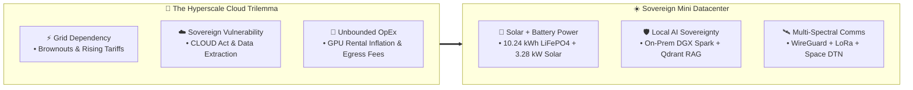
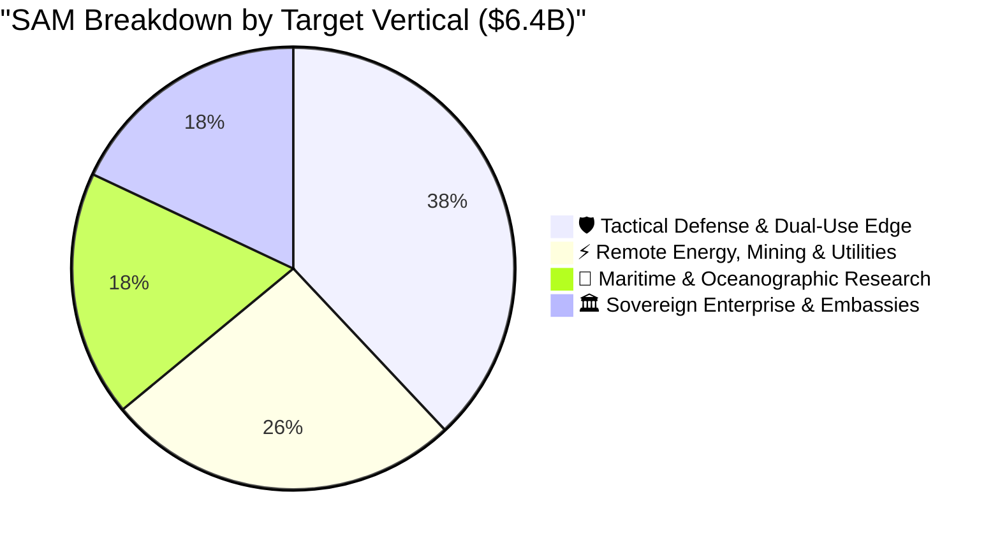
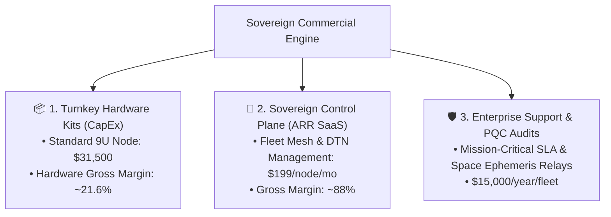
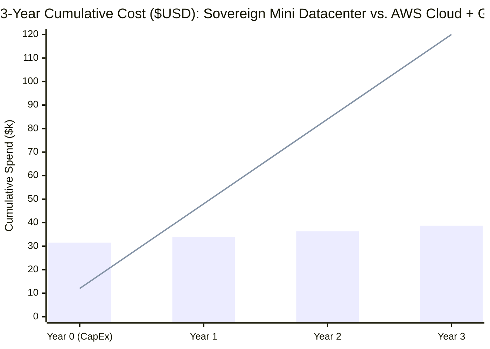
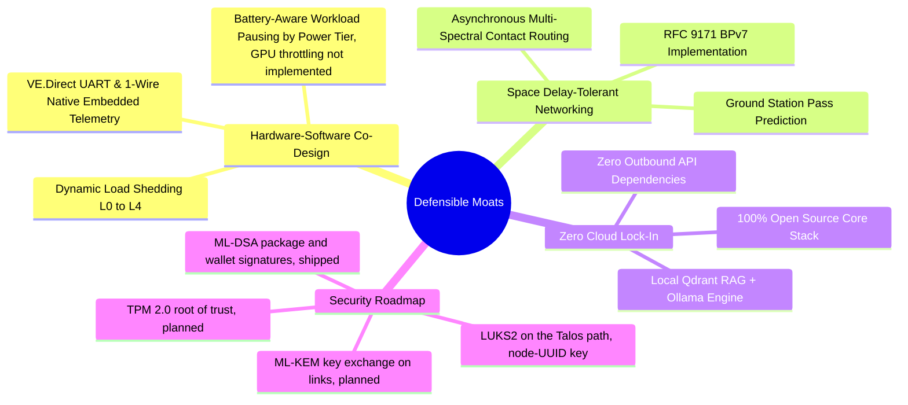

# 💼 Sovereign Mini Datacenter — Commercialization Model & Investment Thesis

> **Document Type**: Executive Whitepaper, Commercialization Strategy & Financial Model  
> **Target Audience**: Institutional Venture Capital, DeepTech / Dual-Use Funds (NATO DIANA / EIC), Sovereign Wealth & CleanTech Investors  
> **Author & Lead Architect**: [Ilias Chrysovergis](https://iliachry.gr) · [Metatopia Studio](https://metatopia.gr) · License: MIT · © 2026

---

## 1. Executive Summary & Investment Thesis

The explosion of Generative AI has collided with two critical macro bottlenecks: **the energy crisis of hyperscale datacenters** and **the erosion of digital sovereignty**. 

Enterprises, tactical defense units, critical infrastructure operators, and sovereign nations are increasingly unwilling or unable to route mission-critical intelligence and intellectual property through centralized US/Chinese cloud providers (AWS, GCP, Azure, Cloudflare) over vulnerable submarine cables and fragile terrestrial grids.



**Sovereign Mini Datacenter (SMDC)** is the world’s first open-source, self-powered, solar-backed 9U micro-datacenter with air-cooled AI nodes and a liquid-cooled host. It delivers **on-premise AI compute on two NVIDIA DGX Spark nodes (256 GB of unified memory in total)**, **10.24 kWh of energy storage**, and **RFC 9171 Space Delay-Tolerant Networking (BPv7)** in a deployable, turnkey form factor that operates with **zero recurring cloud bills** and **100% computational autonomy**.

---

## 2. Market Opportunity & Sizing (TAM / SAM / SOM)

The global edge computing and modular micro-datacenter markets are experiencing unprecedented compound growth driven by AI inference localization, energy volatility, and geopolitical realignments:

```
Total Addressable Market (TAM) ───► $60.4 Billion by 2030 (CAGR 24.8%)
  ├── Edge AI Hardware & Compute: $42.1 Billion
  └── Modular Micro-Datacenters & Off-Grid Power: $18.3 Billion

Serviceable Addressable Market (SAM) ──► $6.4 Billion
  └── High-Reliability, Air-Gapped & Ruggedized Edge Infrastructure

Serviceable Obtainable Market (SOM) ───► $320 Million (Years 1–3)
  └── Dual-Use Defense, Remote Industrial, Maritime & Sovereign Enterprise
```



---

## 3. High-Value Target Customer Verticals

| Vertical | Pain Point Solved | Value Proposition & Buying Trigger | Typical Deal Size |
| :--- | :--- | :--- | :--- |
| **🛡️ Tactical Defense & Dual-Use** | Battlefield communication denial, cloud interception risk, harsh forward operating bases (FOB). | Air-gapped local LLM copilot, LoRa Meshtastic emergency fallback, Space DTN orbital relay, zero thermal runaway (LiFePO4). | \$150k – \$2.5M (Swarm kits) |
| **⚡ Remote Energy & Mining** | Zero fiber connectivity at remote solar farms, offshore wind turbines, and open-pit mines. | Autonomous predictive maintenance AI, satellite burst sync, solar-first power with battery load shedding. | \$75k – \$500k |
| **🚢 Maritime & Offshore** | Satellite bandwidth costs (\$10k+/mo), high latency for maritime AI processing. | On-premise oceanographic telemetry indexing, burst satellite DTN sync during contact passes, salt-resistant aluminum rack. | \$50k – \$300k |
| **🏛️ Sovereign Embassies & Family Offices** | Subpoena risk via CLOUD Act, espionage, power grid instability in unstable regions. | 100% sovereign data residency, local password vault (Vaultwarden), offline-capable private Git/Nextcloud, post-quantum signatures on software packages (post-quantum encryption of links is planned). | \$35k – \$200k |

---

## 4. Business Model & Monetization Architecture

The Sovereign Mini Datacenter leverages a proven **hybrid commercialization model** combining turnkey hardware sales, high-margin recurring SaaS subscriptions, and enterprise SLA contracts:



### Revenue Streams
1. **Turnkey Hardware Deliveries**:
   - **SMDC-Core-9U**: \$31,500 per unit (BOM cost: \$24,701 $\implies$ \$6,799 gross profit per node, a 21.6% gross margin). The BOM is the itemised total in [`hardware/COMPONENTS.md`](hardware/COMPONENTS.md): \$10,801 for the non-compute lines (host, power electronics, battery, array, protection and battery isolators, cabling, cooling, telemetry, network and enclosure) plus 2 × \$6,950 for the DGX Spark nodes (the price NVIDIA lists on its marketplace page, checked on 2026-11-14). Apart from the DGX Spark price, the unit costs are estimates. The BOM excludes assembly labour, shipping, taxes and the site-specific PV mounting structure and conduit, so the realised margin is lower.
   - **SMDC-Rugged-IP67 (Mobile Tactical)**: \$48,900 per unit (MIL-STD-810H vibration and shock damping), priced at the same 1.551× premium over the Core unit as in the original price list (\$38,000 against \$24,500; 1.551 × \$31,500 = \$48,857, rounded to \$48,900). No separate BOM is itemised for this variant.
2. **Sovereign Control Plane (Recurring SaaS ARR)**:
   - WireGuard mesh orchestration, federated Qdrant vector index synchronization, orbital pass scheduling, and remote telemetry monitoring at \$199/node/month.
3. **Custom Engineering & Dual-Use Defense Deployments**:
   - Government and defense integration contracts, post-quantum cryptographic hardening, and air-gapped installation services (\$75,000 – \$250,000 per engagement).

---

## 5. 3-Year Total Cost of Ownership (TCO) vs. Cloud Hyperscalers

A direct financial comparison between deploying a **1-Node Sovereign Mini Datacenter** versus renting equivalent AI compute and cloud services (AWS Outposts / GPU Instances + Diesel Power Generator + Starlink Egress):



### 3-Year Financial Breakdown Table

| Cost Category | Sovereign Mini Datacenter (1 Node) | Hyperscaler Cloud (AWS + Diesel Power) | 3-Year Net Savings |
| :--- | :---: | :---: | :---: |
| **Initial Hardware & Setup (CapEx)** | \$31,500 *(One-time)* | \$12,000 *(Edge gateway & diesel gen)* | -\$19,500 |
| **Electricity / Fuel (3 Years)** | **\$0** *(8-panel array: 14.5 kWh/day annual-average yield vs. 11.2 kWh/day draw)* | \$24,800 *(Diesel fuel + grid tariffs)* | **+\$24,800** |
| **AI Inference & GPU Rental (3 Years)** | **\$0** *(2× DGX Spark on-prem)* | \$54,000 *(\$1,500/mo 2× A100/H100 cloud)* | **+\$54,000** |
| **Data Egress & Cloud SaaS (3 Years)** | **\$0** *(Local Nextcloud / Mailcow)* | \$14,400 *(\$400/mo egress & storage)* | **+\$14,400** |
| **Maintenance & Mesh SaaS (3 Years)** | \$7,164 *(\$199/mo control plane)* | \$14,800 *(Cloud security & support)* | **+\$7,636** |
| **TOTAL 3-YEAR SPEND** | **\$38,664** | **\$120,000** | **+\$81,336 (67.8% Savings)** |

The electricity row uses the sizing calculator's reference duty cycle (both DGX Spark nodes under load 12 h/day): an 11.16 kWh/day draw against a 14.50 kWh/day annual-average yield from the 3,280W array (8 × 410W, 5.2 peak sun hours, 85% system efficiency) leaves a surplus of 3.34 kWh/day, so no energy is bought on an annual-average basis. Yield is seasonal: in low-sun weeks the battery and then a grid or generator top-up carry the shortfall, and that top-up is not costed here. Monthly operating savings are the cloud-side recurring costs minus the SMDC-side recurring costs: (\$108,000 − \$7,164) / 36 = \$2,801.

$$
\text{Payback Period} = \frac{\text{Initial Net CapEx}}{\text{Monthly OpEx Savings}} = \frac{\$19,500}{\$2,801/\text{month}} = \mathbf{7.0\text{ Months}}
$$

> [!TIP]
> **Key Investor Metric (TCO-table scenario)**: Against the cloud + diesel alternative above (\$12,000 capex and about \$3,000/month of running costs), the customer recovers the additional hardware investment in **about 7.0 months**, saving **\$81,336 (67.8%)** over a 3-year operating lifecycle while gaining 100% data sovereignty and battery-backed resilience to grid blackouts.

**Two payback figures, two scenarios.** The 7.0 months above is specific to this table: the alternative carries \$12,000 of its own capex (so only the \$19,500 difference has to be recovered) and \$108,000 of recurring costs over 3 years (\$3,000/month). The [interactive calculator](https://iliachry.gr/sovereign-mini-datacenter/) on the project website opens on a more conservative default: \$2,500/month of cloud spend plus the grid energy the array displaces at \$0.35/kWh, with no capex on the alternative side, so the full \$31,500 has to be recovered from about \$2,420/month of net savings, which gives **13.0 months**. Move its sliders to model any other case; neither figure is a measured customer result.

---

## 6. 5-Year Financial Projections

```
Metric                 Year 1       Year 2       Year 3       Year 4       Year 5
─────────────────────────────────────────────────────────────────────────────────
Nodes Deployed             45          180          620        1,850        4,200
Hardware Revenue       $1.42M       $5.67M      $19.53M      $58.28M     $132.30M
Recurring ARR          $0.11M       $0.54M       $2.02M       $6.44M      $16.45M
Services & SLA         $0.25M       $0.85M       $2.40M       $6.20M      $12.50M
─────────────────────────────────────────────────────────────────────────────────
TOTAL REVENUE          $1.78M       $7.06M      $23.95M      $70.92M     $161.25M
Gross Profit           $0.53M       $2.12M       $7.19M      $21.35M      $49.28M
Gross Margin (%)        29.6%        30.1%        30.0%        30.1%        30.6%
─────────────────────────────────────────────────────────────────────────────────
Operating Expenses     $0.86M       $2.35M       $6.79M      $19.36M      $41.66M
EBITDA                -$0.33M      -$0.23M      +$0.41M      +$1.99M      +$7.62M
EBITDA Margin (%)      -18.4%        -3.3%         1.7%         2.8%         4.7%
Net Operating Cash    -$0.33M      -$0.23M      +$0.41M      +$1.99M      +$7.62M
```

Hardware revenue is nodes deployed × the \$31,500 SMDC-Core-9U list price. Gross profit is derived from the revenue rows above: hardware revenue × 21.6% (the \$6,799 gross profit per \$31,500 node at the reference BOM of \$24,701, i.e. nodes deployed × \$6,799), plus recurring ARR × 88% (the SaaS gross margin stated in Section 4), plus services & SLA revenue × 50%. This document states no margin for services, so the 50% is an assumption; with services at 0% or 100% margin, Year 1 gross margin would be 22.6% or 36.7%. Gross margin is gross profit divided by total revenue. No volume BOM reduction is assumed.

> [!NOTE]
> **How the operating rows are derived.** Operating expenses are an assumption, not a bottom-up cost model: the row is the schedule implied by the first version of this plan (at a \$24,500 list price), carried over unchanged at \$0.86M, \$2.35M, \$6.79M, \$19.36M and \$41.66M for Years 1 to 5. It is derived as implied operating expenses = original gross profit − original EBITDA, where original gross profit = original revenue × original gross margin and original EBITDA = original revenue × original EBITDA margin.
>
> | Original table | Year 1 | Year 2 | Year 3 | Year 4 | Year 5 |
> | :--- | ---: | ---: | ---: | ---: | ---: |
> | Total revenue | \$1.46M | \$5.80M | \$19.61M | \$57.96M | \$131.85M |
> | Gross margin | 46.2% | 54.8% | 63.2% | 67.5% | 69.4% |
> | EBITDA margin | -12.4% | 14.2% | 28.6% | 34.1% | 37.8% |
> | Implied operating expenses | \$0.86M | \$2.35M | \$6.79M | \$19.36M | \$41.66M |
>
> EBITDA in the table above = gross profit − operating expenses, and EBITDA margin = EBITDA ÷ total revenue. In the original table net operating cash equalled revenue × EBITDA margin to within rounding (\$0.01M) in every year, so net operating cash is set equal to EBITDA here as well; no working-capital, tax or capital-expenditure effects are modelled. The original gross margins (46–69%) assumed a much lower BOM than the itemised one, which is why EBITDA is far lower here than in the original table, and why it turns positive in Year 3 rather than Year 2.
>
> **Status of these figures.** Because operating expenses are an assumption carried over from the original plan, the EBITDA and cash rows are a scenario, not a forecast: they show what the stated revenue and the itemised BOM imply if spending follows that schedule. Sensitivity of the result to the assumption, computed from the table (EBITDA = gross profit − operating expenses × factor):
>
> | Operating expenses in Year 5 | Year 5 operating expenses | Year 5 EBITDA | Year 5 EBITDA margin |
> | :--- | ---: | ---: | ---: |
> | 20% lower | \$33.33M | +\$15.95M | 9.9% |
> | As assumed | \$41.66M | +\$7.62M | 4.7% |
> | 20% higher | \$50.00M | -\$0.72M | -0.4% |

---

## 7. Defensible Competitive Moats



1. **Energy-Aware Tiered Load Shedding**: Unlike standard clusters that ignore off-grid state of charge, SMDC tracks workloads across priority tiers (`L0`–`L4`) and pauses lower-priority tiers as battery State-of-Charge drops across configurable thresholds (50 / 30 / 20 / 10 %; hardware GPU throttling and cross-node workload dispatch are design targets, not implemented).
2. **Space DTN Store-and-Forward Stack**: Queues RFC 9171 BPv7-style bundles in local SQLite/NVMe storage for simulated LEO orbital contact passes alongside terrestrial WireGuard mesh and outbound Meshtastic LoRa alert framing (automatic multi-transport failover is a design target, not implemented).
3. **True Open Architecture**: Zero licensing lock-in empowers government, defense, and privacy-first enterprise clients to audit every line of firmware and software code.

---

## 8. Pitch Deck Slide-by-Slide Outline

```
Slide 01: Title ────────────── Sovereign Mini Datacenter: Solar-Powered Sovereign AI Infrastructure
Slide 02: The Problem ──────── Energy Crises, Cloud Lock-In & Digital Sovereignty Loss
Slide 03: The Solution ─────── Turnkey 9U Micro-Datacenter: Solar, Battery, Local AI
Slide 04: Product Demo ─────── Live 3D WebGL Digital Twin & Physical Hardware Specs
Slide 05: Market Size ──────── $60.4B TAM / $6.4B SAM (Dual-Use Defense, Remote Industry)
Slide 06: Unit Economics ───── 67.8% 3-Year TCO Savings ($81.3k saved per node, 7.0 mo payback vs. the
                               $12k-capex cloud + diesel alternative of the TCO table; the website
                               calculator's $2,500/mo cloud-only default gives 13.0 mo)
Slide 07: Business Model ───── Turnkey Hardware ($31.5k) + Sovereign SaaS ($199/node/mo)
Slide 08: Traction & Code ──── 1382 Automated Tests, 92.5% Coverage, Ready-to-Deploy Stacks
Slide 09: Technology Moat ──── Space DTN (RFC 9171), Energy Load-Shedder, PQC Signatures
Slide 10: Financials ───────── $1.78M Y1 -> $23.95M Y3 -> $161.25M Y5 (4.7% EBITDA in Y5, scenario)
Slide 11: Team & Advisory ──── Metatopia Studio: DeepTech Systems, AI & Embedded Engineers
Slide 12: The Ask ──────────── $2.5M Seed Round to scale batch manufacturing & certifications
```

---

## 9. Contact & Investment Inquiries

- **Primary Contact**: Ilias Chrysovergis, Founder & Lead Architect
- **Website / Portfolio**: [iliachry.gr](https://iliachry.gr)
- **Studio**: Metatopia Studio (`https://metatopia.gr`)
- **Email**: `ilias@metatopia.gr`
- **Repository**: [github.com/iliachry/sovereign-mini-datacenter](https://github.com/iliachry/sovereign-mini-datacenter)
- **Live 3D Digital Twin**: [iliachry.gr/sovereign-mini-datacenter/](https://iliachry.gr/sovereign-mini-datacenter/)
