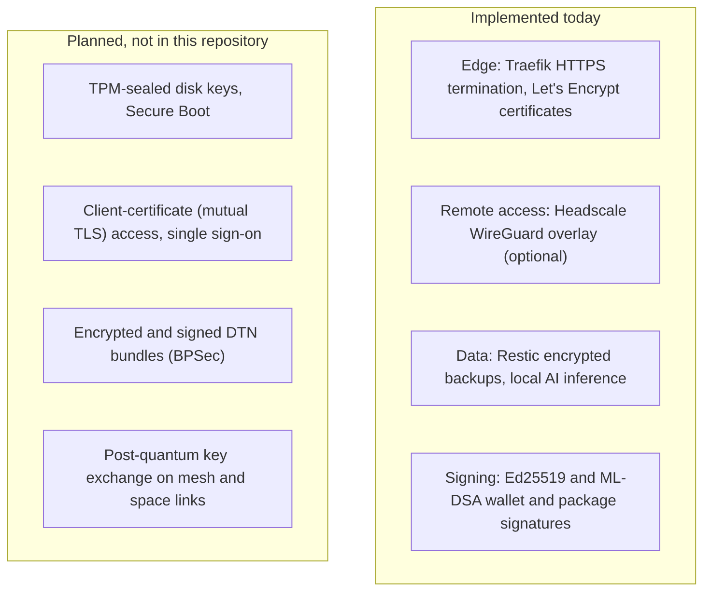
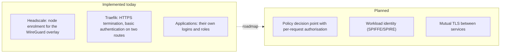
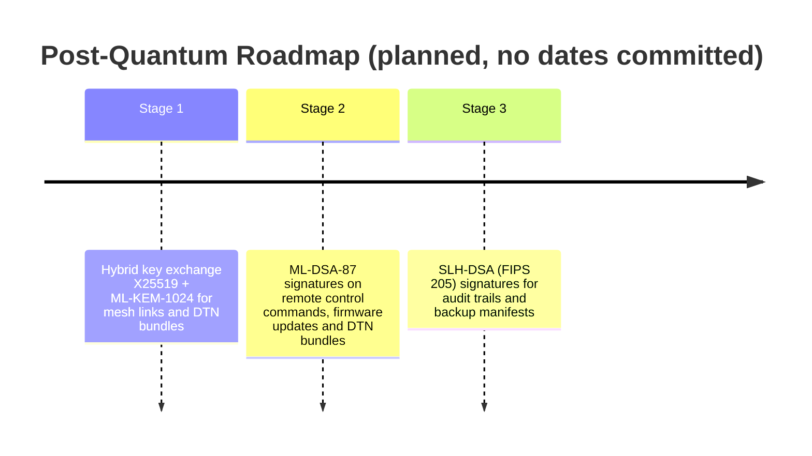
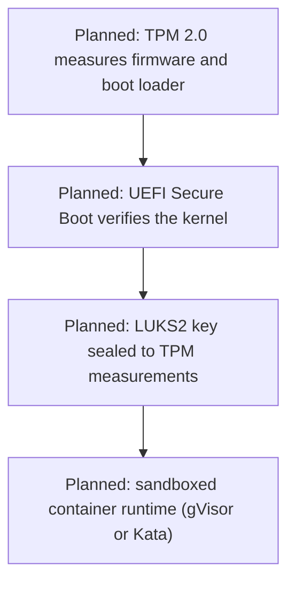

# 🛡️ Sovereign Mini Datacenter — Security Controls & Compliance Mapping

> **Document Type**: Control inventory and framework mapping (self-assessment)  
> **Target Audience**: Chief Information Security Officers (CISOs), Compliance Auditors, Defense Security Officers & Enterprise Architects  
> **Author & Lead Architect**: [Ilias Chrysovergis](https://iliachry.gr) · [Metatopia Studio](https://metatopia.gr) · License: MIT · © 2026

---

## 1. Scope and Status

**The Sovereign Mini Datacenter (SMDC) is not certified, attested or audited against any framework.** No SOC 2 report, ISO/IEC 27001 certificate, FIPS 140-3 validation or GDPR assessment exists for this project. Certification applies to an operating organisation and its processes, not to a repository; an operator who deploys SMDC remains responsible for its own audit.

This document does two things:

1. It lists the security controls that the repository **ships today**, each with the file that implements it.
2. It maps those controls, and the controls that are **planned** or **absent**, to SOC 2, ISO/IEC 27001:2022, NIST SP 800-53 and NIST SP 800-207, so that an operator can see what it must add.

Every row carries one of four status labels:

| Status | Meaning |
| :--- | :--- |
| **Implemented** | Present in this repository and enabled by the reference deployment. |
| **Partial** | Part of the control exists; the row says which part, and what is missing. |
| **Planned** | Design intent on the roadmap. No code or configuration for it exists in this repository. |
| **Not implemented** | Absent and not on the roadmap, or left to the operator. |

The reference deployment has two paths. The **Docker Compose path** (`software/`) is the primary one. The **Talos/Kubernetes path** (`terraform/`, `kubernetes/`) is an alternative; controls that exist on only one path say so.



---

## 2. Controls Implemented Today

| Area | What exists | Evidence | Limits |
| :--- | :--- | :--- | :--- |
| **TLS at the edge** | Traefik terminates HTTPS on port 443 with Let's Encrypt certificates and redirects port 80 to HTTPS. | `software/docker-compose.yml` (service `traefik`) | Server-side TLS only. No client certificates are requested (no mutual TLS). Traffic between Traefik and the containers on the Docker bridge is plain HTTP. |
| **Edge authentication** | HTTP basic authentication on the Traefik dashboard and the Prometheus route. Every other application (GitLab, Nextcloud, OpenProject, Vaultwarden, Grafana, Open WebUI) uses its own login. | `software/docker-compose.yml` (middleware `traefik-auth`) | No single sign-on, no forward-auth proxy and no enforced second factor at the edge. Each application's own two-factor and role settings must be enabled by the operator. |
| **Remote access VPN** | Optional Headscale control plane for a WireGuard mesh (address range `100.64.0.0/10`), with a self-hosted relay and no third-party relay map. | `software/vpn/docker-compose.vpn.yml`, `software/vpn/config/headscale.yaml` | Optional overlay (`./setup.sh --with-vpn`). The repository ships no access-control policy file; with Headscale's default policy every enrolled node can reach every other enrolled node. |
| **Node-to-node WireGuard (Terraform path)** | Key pairs and one pre-shared key per node pair for a full WireGuard mesh. | `terraform/modules/wireguard-mesh/main.tf` | Generates configuration only; keys are held in Terraform state, which the operator must protect. |
| **Intrusion detection** | Optional CrowdSec engine that reads the Traefik access log and host logs. | `software/security/docker-compose.crowdsec.yml` | Detection only. No bouncer is configured, so nothing is blocked. |
| **Host hardening audit** | `smdc audit` checks kernel settings (ASLR, SYN cookies, reverse-path filter), Docker socket exposure, privileged containers, host firewall state and `.env` file permissions and placeholders. | `src/sovereign_dc/security/audit.sh`, `src/sovereign_dc/cli.py` (`cmd_audit`) | It reports; it does not change the host. It is a hardening check, not a SOC 2 or ISO audit. Linux only. |
| **Encrypted backups** | Restic snapshots, encrypted and authenticated by Restic (AES-256 with Poly1305-AES), with a retention policy. Default interval 24 hours, default repository a local directory. | `software/backup/backup.sh`, `software/backup/docker-compose.backup.yml`, `software/backup/README.md` | Optional overlay. Off-site copies exist only if the operator points `RESTIC_REPOSITORY` at a remote store. Snapshots are not immutable. |
| **Disk encryption (Talos path)** | LUKS2 on the Talos STATE and EPHEMERAL partitions. | `terraform/modules/talos-cluster/main.tf`, `kubernetes/talos-config.yaml` | The key is derived from the node's hardware UUID (`nodeID`), not sealed in a TPM. It protects a disk removed from the node; it does not protect a stolen node, which unlocks itself at boot. |
| **Talos management API** | Talos nodes have no SSH and no shell; `talosctl` uses mutually authenticated TLS, a property of Talos itself. | `terraform/README.md`, `kubernetes/talos-config.yaml` | Applies to the Talos management API only, not to the applications. |
| **Dashboard control authentication** | Operator bearer token (`SMDC_DASHBOARD_TOKEN`) compared in constant time for control requests and for non-local reads. | `src/sovereign_dc/web/dashboard.py` (`_bearer_token_matches`, `_check_post_auth`) | A shared static token. Commands are not signed. |
| **Wallet and ledger signatures** | Ed25519 (RFC 8032) node wallets, with ML-DSA-87 (FIPS 204 algorithm) as an option; a wallet keystore is encrypted with AES-256-GCM when a keystore password is supplied. | `src/sovereign_dc/economy/wallet.py`, `src/sovereign_dc/security/pqc.py` | The lattice code is the pure-Python `dilithium-py` / `kyber-py` libraries. They are not constant-time, not FIPS-validated and not independently audited. |
| **Application package signatures** | `.smdc-app` packages can carry an ML-DSA-87 signature, verified on install. | `src/sovereign_dc/enterprise/manager.py` | Same library caveat as above. |
| **DTN bundle integrity** | Each bundle carries SHA-256 digests over its header fields and payload. | `src/sovereign_dc/space/dtn/bundle.py` | Integrity against corruption only. The payload is base64-encoded, which is **not** encryption, and the digest is not keyed or signed, so it provides neither confidentiality nor authentication. |
| **Telemetry bridge firmware** | The ESPHome variant uses an encrypted native API key and a password for over-the-air updates. | `firmware/esphome_smdc_bridge.yaml` | Updates are password-protected, not signed. |
| **Supply chain** | Container images pinned to exact versions; `pip-audit` dependency audit, lint, type checks and the test suite (coverage gate of 85%) run in CI. | `software/docker-compose.yml`, `.github/workflows/ci.yml`, `pyproject.toml` | Images are pinned by tag, not by digest. No SBOM is published. |
| **Local data processing** | Inference (Ollama), vector search (Qdrant) and the collaboration services run on the node; no component in this repository sends prompts, embeddings or metrics to a vendor cloud. | `software/docker-compose.yml` | The telemetry and update-check settings of the third-party images have not been audited. Let's Encrypt certificate issuance contacts the internet. |

---

## 3. SOC 2 Trust Services Criteria Mapping

| SOC 2 Category | Trust Services Principle | Status | What exists, and what is missing |
| :--- | :--- | :--- | :--- |
| **CC6.1 – CC6.3** | **Logical Access Controls** | **Partial** | Exists: per-application logins, basic authentication on the Traefik dashboard and Prometheus, optional Headscale WireGuard VPN, Vaultwarden password vault (it supports FIDO2/WebAuthn once the operator enables it). Missing: single sign-on, enforced two-factor authentication at the edge, a VPN access-control policy, access reviews. |
| **CC6.6 – CC6.8** | **Data Boundary & Perimeter** | **Partial** | Exists: only ports 80, 443 and GitLab SSH (2222) are published by the core stack; `smdc audit` reports the host firewall state. Missing: network segmentation (all services share one Docker bridge network, `sovereign_net`), shipped firewall rules, egress filtering. |
| **CC7.1 – CC7.4** | **System & Threat Monitoring** | **Partial** | Exists: CrowdSec intrusion detection (no bouncer wired), Prometheus and Grafana dashboards (no alert rules are shipped). The Sentinel Copilot publishes the power mode from battery SoC and PV power; it is not a security monitor. Missing: alerting, incident response procedures, log retention policy. |
| **A1.1 – A1.3** | **Availability** | **Partial** | Exists as hardware design: 10.24 kWh LiFePO4 bank (2 × 5.12 kWh), 3,280W solar array on one MPPT charge controller, and five power modes ($L_0 \to L_4$) in software (`tests/test_telemetry.py`). Missing: a measured availability figure, redundancy of the single inverter and single charge controller, a tested disaster-recovery procedure. |
| **C1.1 – C1.2** | **Confidentiality of Data** | **Partial** | Exists: TLS at the edge, WireGuard (ChaCha20-Poly1305) on the optional VPN, encrypted Restic backups, LUKS2 on the Talos path (key derived from the node UUID). Missing: disk encryption on the Docker Compose path (the operator must set it up on the host), TPM-sealed keys, encryption of DTN bundle payloads. |

---

## 4. ISO/IEC 27001:2022 Annex A Control Mapping

| ISO 27001 Control | Control Objective | Status | What exists, and what is missing |
| :--- | :--- | :--- | :--- |
| **A.5.15 Access Control** | Restricting access to network and assets | **Partial** | Exists: the role models built into GitLab, Nextcloud and OpenProject, each with its own accounts, reached over HTTPS. Missing: mutual TLS (no client certificates are configured in Traefik), central identity. |
| **A.8.1 User End-Point Devices** | Protection of edge computing endpoints | **Planned** | TPM-sealed keys and Secure Boot are design intent only. The repository contains no TPM, Secure Boot or measured-boot configuration. The enclosure design has no lock or intrusion switch. |
| **A.8.7 Protection Against Malware** | Defence against attacks | **Partial** | Exists: CrowdSec reading the reverse-proxy access log (detection only; no IP-ban bouncer). Missing: blocking, malware scanning. |
| **A.8.20 Network Security** | Segregation and security of networks | **Partial** | Exists: optional WireGuard overlay; DTN store-and-forward and a Meshtastic LoRa gateway as alternative transports. LoRa confidentiality is the Meshtastic channel encryption configured on the radio, not something this repository adds. Missing: network segregation between services, automatic failover between transports (the `transport_priority` field in `software/mesh/cluster_config.yaml` is declarative; no code in `src/sovereign_dc/mesh/` reads it or switches transports). |
| **A.8.24 Use of Cryptography** | Key management and strong algorithms | **Partial** | Exists: Restic encrypted backups, Ed25519 node wallets, optional ML-DSA-87 signatures, password-protected AES-256-GCM wallet keystores. Missing: a key-management policy, key rotation, hardware key storage. ML-KEM is present as a library and self-test (`smdc security pqc`) and is not used by any transport. |

---

## 5. NIST SP 800-207 (Zero Trust) and NIST SP 800-53 Rev 5

**NIST SP 800-207 status: Not implemented.** A zero-trust architecture needs a policy decision point that authorises every request from device and user identity. SMDC has none. What it has is a private overlay network (Headscale/WireGuard) in which enrolled nodes are trusted, plus per-application logins. Workload identity (SPIFFE/SPIRE) and mutual TLS between services are **planned**; no code or configuration for them exists.



### NIST 800-53 Control Crosswalk

| NIST Control ID | Control Description | Status | What exists, and what is missing |
| :--- | :--- | :--- | :--- |
| **AC-3 Access Enforcement** | Enforce approved authorizations | **Partial** | Exists: on the optional WireGuard overlay each node is identified by its public key; applications enforce their own roles; dashboard controls require a bearer token. Missing: per-request policy enforcement, signed commands. |
| **SC-8 Transmission Confidentiality** | Protect data in transit | **Partial** | Exists: ChaCha20-Poly1305 on WireGuard links, TLS on the Traefik edge (TLS 1.2 and 1.3, Traefik defaults; no minimum version is pinned), Meshtastic channel encryption on LoRa when a radio is attached and configured. Missing: confidentiality on the DTN path. DTN bundles are **not encrypted**: the payload is base64-encoded and protected only by SHA-256 integrity digests. Traffic between Traefik and the containers is unencrypted on the Docker bridge. |
| **SC-13 Cryptographic Protection** | Employ validated cryptography | **Not implemented** | No FIPS 140-3 validated module is used. Classical primitives come from the Python `cryptography` package (OpenSSL, not in FIPS mode); the ML-DSA and ML-KEM code is pure Python and unvalidated. |
| **CP-9 Information System Backup** | Back up system data | **Partial** | Exists: Restic deduplicated, encrypted and authenticated snapshots, every 24 hours by default, to a local repository; a remote repository (for example S3-compatible) if the operator configures one. Missing: immutability, an off-site copy by default, a tested restore of every database (see `software/backup/README.md` for what is covered). |

---

## 6. Post-Quantum Cryptography (PQC)

### Implemented today

- **ML-DSA signatures (FIPS 204 algorithm)**: `PQCSigner` in `src/sovereign_dc/security/pqc.py`, used for optional ML-DSA-87 node wallets (`smdc economy wallet --create --pqc`) and for `.smdc-app` package signatures.
- **ML-KEM key encapsulation (FIPS 203 algorithm)**: `PQCKEM` in the same module, exercised by the `smdc security pqc` self-test and benchmark. **It is not wired into any transport**: WireGuard links, TLS and DTN bundles do not use it.
- Both are backed by the pure-Python `dilithium-py` and `kyber-py` libraries. They implement the standardised algorithms but are **not** FIPS-validated, not constant-time and not audited, so they must not be relied on against an adversary who can measure timing.

### Planned (roadmap; none of this is implemented)



| Item | Status today |
| :--- | :--- |
| Hybrid X25519 + ML-KEM key exchange on WireGuard or DTN | **Planned.** WireGuard uses its standard Curve25519 handshake; the Terraform path adds a pre-shared key per node pair. |
| ML-DSA authentication of remote control commands | **Planned.** Dashboard controls are authenticated with a bearer token. |
| ML-DSA-signed firmware updates | **Planned.** ESPHome over-the-air updates are protected by a password. |
| Signed or encrypted DTN bundles (RFC 9172 BPSec) | **Planned.** Bundles carry unkeyed SHA-256 digests only. |
| SLH-DSA (SPHINCS+) | **Planned.** No code exists. |

---

## 7. Hardware Root of Trust & Physical Security

**Status: Planned. Nothing in this section is implemented.** The repository contains no TPM, Secure Boot, measured-boot or attestation configuration, and no sandboxed container runtime.



| Control | Status | Today |
| :--- | :--- | :--- |
| LUKS2 disk encryption | **Partial** | Talos path only, keyed to the node UUID (`nodeID`). The Docker Compose path configures no disk encryption; the operator sets it up on the host. |
| TPM-sealed disk keys (keys bound to PCR measurements) | **Planned** | Not configured. Talos supports TPM-sealed keys; switching `keys` from `nodeID` to `tpm` in `terraform/modules/talos-cluster/main.tf` is the intended change. |
| UEFI Secure Boot | **Planned** | Not configured. |
| Sandboxed container runtime (gVisor / Kata) | **Planned** | Containers run on the default Docker runtime (runc). |
| Chassis intrusion detection and key purge | **Not implemented** | The enclosure has no intrusion switch and the firmware has no tamper input. The rack-door control in the dashboard and the 3D twin changes a software state only. |
| Hardware security module for signing keys | **Not implemented** | Node keys are files in the state directory; a wallet keystore is encrypted only when a password is supplied. |

---

## 8. Data Residency and GDPR

SMDC is infrastructure. Whether a deployment complies with the GDPR depends on the operator: its lawful basis, records of processing, data-subject procedures, processor contracts and risk assessment. This repository provides none of those, and makes no compliance claim. What the design contributes:

- **Local processing (implemented)**: prompts, embeddings, documents and metrics are processed and stored on the node. No component in this repository sends them to a third party. This removes the international-transfer question (Chapter V, *Schrems II*) for that data **as long as** the operator does not configure a remote backup target, an external relay or an external model API outside the EU/EEA.
- **Security of processing, Article 32 (partial)**: the technical measures in section 2 exist. Encryption is **not** end-to-end: TLS ends at Traefik, disk encryption on the Docker Compose path is left to the operator, and DTN bundles are not encrypted.
- **Offline operation (implemented in software, not field-tested)**: inference, indexing and the collaboration services do not depend on an internet connection once the images and models are present. Certificate issuance by Let's Encrypt does; an isolated deployment needs its own certificate authority.

---

## 9. Verification Commands

```bash
# Host hardening audit (Linux): kernel settings, Docker exposure, firewall state, .env hygiene
smdc audit

# ML-DSA and ML-KEM self-test and timing
smdc security pqc

# Lint, formatting, typing and the test suite with the coverage gate
bash scripts/quality_gate.sh
```

These commands check the controls listed as implemented in section 2. They do not produce audit evidence for any certification.
