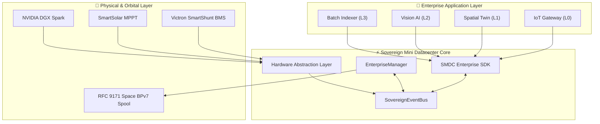
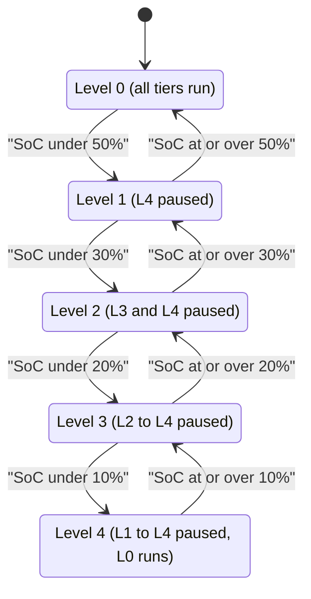

# 🏢 Enterprise Application Onboarding & Coupling Guide

> **Sovereign Mini Datacenter (SMDC)**  
> **Target Audience**: Enterprise Software Engineers, Cloud/Edge Architects, DevOps & Systems Integrators  
> **Scope**: Declarative manifest specification (`smdc-app.yaml`), zero-dependency SDK (`sovereign_dc.enterprise.sdk`), solar-aware power tiers, lifecycle management, and Post-Quantum Cryptography packaging.

---

## 1. Executive Summary & Value Proposition

The **Sovereign Mini Datacenter (SMDC)** enterprise framework enables organizations to deploy, manage, and scale their proprietary or open-source software workloads on sovereign, off-grid, solar-backed edge compute nodes without cloud lock-in.

Whether deploying industrial IoT pipelines, computer vision models, geospatial digital twins, or confidential databases, the SMDC runtime provides:

1. **Energy-Aware Power Tiers**: Tracked workloads are marked paused and resumed according to the battery State-of-Charge (SoC) through graduated power tiers ($L_0 \to L_4$); section 3 states exactly what is enforced.
2. **Post-Quantum Package Signatures**: Application bundles can be signed with ML-DSA-87 (the FIPS 204 algorithm), and node wallets can use it for ledger transactions. The implementation is a pure-Python library that is not FIPS-validated; see [`COMPLIANCE.md`](COMPLIANCE.md) for what is implemented and what is planned.
3. **Delay-Tolerant Space Relaying**: Integrated RFC 9171 BPv7 DTN communication spools critical event payloads for a Low Earth Orbit (LEO) satellite contact window during terrestrial link outages (the repository ships the bundle spool and a pass predictor, not a radio driver; bundle payloads are not encrypted).
4. **Autonomous AI Multi-Agent Supervision**: Built-in Sentinel and Technician Copilots monitor workload health, resource quotas, and thermals.



---

## 2. The Application Manifest Specification (`smdc-app.yaml`)

Every enterprise application contains a root descriptor named `smdc-app.yaml` (or `smdc-app.json`).

### Full Schema Reference

```yaml
# Sovereign Mini Datacenter (SMDC) — Enterprise Application Manifest
name: "Smart Factory Analytics"
app_id: "smart-factory-analytics"
version: "1.0.0"
description: "Real-time edge analytics and predictive maintenance for assembly line sensors."
author: "Factory Automation Group"
category: "ai_inference" # iot | ai_inference | spatial_media | database | distributed | web_service | custom
runtime: "process"       # process | docker | systemd | wasm

# Execution Entrypoint
entrypoint: "python3 main.py --config config.json"

# Hardware Resource Allocations
resources:
  cpu_cores: 2.0         # Fractional CPU core allocation
  ram_mb: 2048           # Memory reservation in Megabytes
  gpu_vram_mb: 2048      # GPU memory quota in Megabytes
  storage_mb: 4096       # Local NVMe disk quota
  gpu_required: true     # NVIDIA CUDA / TensorRT dependency
  max_power_w: 35.0      # Maximum expected electrical draw in Watts

# Load-Shedding Policy (section 3 says exactly what is enforced)
power:
  tier: "L2_BACKGROUND"  # L0_CRITICAL | L1_STANDARD | L2_BACKGROUND | L3_DEFERRABLE | L4_IDLE
  min_battery_soc: 40.0  # Enforced: marked paused while a reported battery SoC is below this (ignored for L0_CRITICAL)
  max_ambient_temp_c: 55.0 # Reserved, not enforced: validated and stored only
  allow_solar_burst: true # Reserved, not enforced: validated and stored only
  min_solar_watts: 250.0  # Reserved, not enforced: validated and stored only

# Network & Multi-Spectral Connectivity
network:
  ports: [8080, 8443]    # Listening service ports
  expose_wireguard: true # Peered across the WireGuard mesh
  space_dtn_enabled: true # Authorized to spool RFC 9171 BPv7 satellite bundles
  lora_heartbeat: true   # Transmit emergency telemetry over Sub-GHz LoRa

# Storage Persistence & Backup
storage:
  persistent_volume: "factory-analytics-data"
  mount_point: "/var/lib/smdc/apps/smart-factory-analytics/data"
  backup_enabled: true   # Declaration of intent only: NOT backed up automatically (see below)

# Health Probes & Auto-Restart
health_check:
  type: "http"           # http | tcp | process
  endpoint: "/health"
  port: 8080
  interval_sec: 15
  timeout_sec: 5
  max_retries: 3
```

> **`storage.backup_enabled` does not back anything up.** The field is stored in the manifest as a declaration of intent; no backup job reads it, and an application's volume is not part of the node's Restic backup set. `smdc app validate` and `smdc app register` print a notice when it is `true`. To really include the volume, an operator edits the backup set by hand (see [`software/backup/README.md`](software/backup/README.md)):
>
> 1. Add one line for the Docker volume to `software/backup/volumes.conf`, in its format `key|name|class|paths|reason`, for example `factory_analytics_data|factory-analytics-data|files|.|smart-factory-analytics application data` (`name` is the volume's fixed Docker name, or `-` for a volume scoped to the Compose project; class `files` is a file-level copy, so an application that keeps a live database in the volume must also export a dump into it).
> 2. If the backup container is used (`setup.sh --with-backup`), declare the volume in `software/backup/docker-compose.backup.yml` and mount it read-only at `/data/<key>`; `scripts/validate_compose.sh` checks that the mounts and `volumes.conf` agree.
>
> Snapshots are encrypted, but the default repository (`RESTIC_REPOSITORY=/var/backups/sovereign`) is on the node itself: it is off-site only if you point `RESTIC_REPOSITORY` at a remote backend (`s3:`, `sftp:`, `rest:`) or copy the repository elsewhere.

---

## 3. Power Shedding Tiers ($L_0 \to L_4$)

Load shedding has one policy and one set of thresholds. The battery state of charge (SoC) maps to a **shedding level** from 0 to 4, and each application's `power.tier` decides from which level the application is paused.

**What "paused" means.** The `EnterpriseManager` is a state tracker, not a process supervisor: it marks the tracked application `paused` and publishes `enterprise.<app_id>.paused`, and an application that uses `AppLifecycleHandler` gets its `on_pause` / `on_resume` callbacks and stops its own work. Nothing in this repository throttles, reschedules or terminates an application, and no hardware is switched. The events travel on the in-process event bus, so they reach a manager (and an SDK handler) that runs in the same process as the publisher, such as `smdc benchmark --shed` or the MCP tool `set_load_shedding`; the containerised sentinel shares only its mode file.

### Shedding levels

<!-- shedding-levels:begin (tests/test_regress_round4_shedding.py compares this table with the code defaults) -->
| Shedding level | Battery SoC | Sentinel mode | App tiers the `EnterpriseManager` marks paused | Other components |
| :---: | :--- | :--- | :--- | :--- |
| **0** | at or above 50 % | `NORMAL` (`SOLAR_SURPLUS_COMPUTE` while PV power is above 1000 W and SoC above 75 %) | none | none |
| **1** | below 50 % | `NORMAL` | `L4_IDLE` | none |
| **2** | below 30 % | `ECO_PRESERVATION` | `L3_DEFERRABLE`, `L4_IDLE` | The knowledge indexer defers its batch work while the mode file says `ECO_PRESERVATION`. |
| **3** | below 20 % | `ECO_PRESERVATION` | `L2_BACKGROUND`, `L3_DEFERRABLE`, `L4_IDLE` | The power exporter sets `sovereign_load_shedding_active` to 1; `load_shedder.sh` raises its low-battery cause. |
| **4** | below 10 % | `ECO_PRESERVATION` | `L1_STANDARD`, `L2_BACKGROUND`, `L3_DEFERRABLE`, `L4_IDLE` | Same as level 3. |
<!-- shedding-levels:end -->

The thresholds are `SovereignConfig.shedding_l1_soc` to `shedding_l4_soc`, set with the environment variables `SHEDDING_L1_SOC`, `SHEDDING_L2_SOC`, `SHEDDING_L3_SOC` and `SHEDDING_L4_SOC` (defaults 50, 30, 20 and 10). The sentinel copilot, the dashboard's SoC tier label, the MCP `recommended_level`, the power exporter (`SHEDDING_L3_SOC`) and `load_shedder.sh` (`SHEDDING_L3_SOC`, `SHEDDING_L1_SOC`) read the same variables with the same defaults. The four thresholds are one policy: they must be numbers within 0–100 with L1 > L2 > L3 > L4, otherwise the Python components log one warning and use all four defaults, and `load_shedder.sh` exits 2 without deciding. The table gives the SoC at which a level is **entered**. The sentinel, which tracks the level over time, **leaves** a level only once the SoC is `SHEDDING_HYSTERESIS_SOC` points (default 2, range 0–10) above that level's threshold: 12, 22, 32 and 52 % with the defaults, so an SoC hovering at a threshold does not pause and resume applications on every poll. Stateless readers (the dashboard's SoC tier label, the MCP `recommended_level`) and a sentinel that has just started use the table as it stands. While the SoC is unknown the sentinel holds its last mode and level and publishes nothing.

### Application tiers

| Tier | `power.tier` | Typical workloads | Marked paused from | Resumed when |
| :--- | :--- | :--- | :--- | :--- |
| **$L_0$** | `L0_CRITICAL` | Telemetry, security vault, LoRa gateway | never | n/a |
| **$L_1$** | `L1_STANDARD` | Core web APIs, spatial twins, low-power inference | level 4 | the level is 3 or lower |
| **$L_2$** | `L2_BACKGROUND` | Computer vision pipelines, real-time ingestion | level 3 | the level is 2 or lower |
| **$L_3$** | `L3_DEFERRABLE` | Model retraining, document vectorisation, archival sync | level 2 | the level is 1 or lower |
| **$L_4$** | `L4_IDLE` | Speculative compute, benchmark sweeps | level 1 | the level is 0 |

Rules that hold for every tier:

- Only a tracked application in state `running` is paused, and only an application that shedding paused is resumed. An operator's manual pause stays in force until the operator resumes the application. The entry point for it is the long-running process that holds the manager: the MCP tool `manage_enterprise_app` (`action: "pause"` / `"resume"`) or `EnterpriseManager.pause_app()` / `resume_app()` in that process. The `smdc` CLI has no `app pause` command: each invocation is a separate process whose manager state lives in memory only, so a one-shot CLI command could not hold a pause.
- The policy is applied when a `load_shedding.*` event arrives, and again when an application is started: the manager remembers the level and SoC of the last event, and `smdc app start` (or `start_app`) on an application that this level, or its `min_battery_soc`, would pause starts it **paused by shedding** (`enterprise.<app_id>.started` followed by `enterprise.<app_id>.paused` with `paused_by: load_shedding`). The call succeeds, its message names the level, and the application is resumed like any other shed application when shedding eases. A manager that has not seen an event yet (a new process, such as one `smdc app start` invocation) knows no level and starts the application running.
- The sentinel publishes an event when its mode or the level changes, and again whenever the SoC has moved by 1 percentage point since the last event.

### Per-application manifest fields

| Field | Status | Behaviour |
| :--- | :--- | :--- |
| `power.tier` | **Enforced** | See the two tables above. |
| `power.min_battery_soc` | **Enforced** (not for `L0_CRITICAL`) | When an event carries `battery_soc` (the sentinel's events do; the MCP tool's do not), the application is marked paused while that SoC is below the value, in addition to the tier rule. It is resumed once an event reports an SoC at or above the value plus 2 points and the tier rule no longer applies. An event without `battery_soc` neither pauses nor resumes on this rule. |
| `power.max_ambient_temp_c` | Reserved, not enforced | Validated and stored only. No component pauses an application because of a temperature. |
| `power.allow_solar_burst` | Reserved, not enforced | Stored only. |
| `power.min_solar_watts` | Reserved, not enforced | Validated and stored only. No component compares it with PV power. |

`smdc app validate` prints the enforced rule and the reserved fields for the manifest it checks.



The diagram shows neighbouring transitions only, and its recovery arrows name the thresholds: a reading can move the level by more than one step, and the sentinel takes a recovery arrow only once the SoC is `SHEDDING_HYSTERESIS_SOC` points (default 2) above the threshold on it.

---

## 4. Step-by-Step Developer Onboarding Tutorial

### Step 1: Initialize Project Scaffold
Use the `smdc app init` command to create a starter repository:

```bash
smdc app init "Predictive Maintenance" \
  --app-id "predictive-maint" \
  --category ai_inference \
  --runtime process \
  --power-tier L2_BACKGROUND \
  --entrypoint "python3 app.py" \
  --gpu \
  --target-dir ./predictive-maint
```

This generates:
- `smdc-app.yaml`: Canonical manifest descriptor
- `smdc-app.json`: JSON schema equivalent
- `app.py`: Starter Python code wired to `sovereign_dc.enterprise.sdk`
- `Dockerfile`: Multi-architecture container recipe
- `README.md`: Project documentation

`smdc app init` never overwrites silently. If any of these files already exists in the target directory it lists them, writes nothing and exits non-zero, so re-running it on an application under development cannot destroy its code. Pass `--force` to replace them anyway: each existing file is first moved to `<name>.bak-<UTC timestamp>` beside it, then the new file is written.

```bash
smdc app init "Predictive Maintenance" --app-id "predictive-maint" --target-dir ./predictive-maint --force
```

---

### Step 2: Implement Application Logic with SMDC SDK

```python
"""Predictive Maintenance Engine with SMDC SDK Integration."""

import logging
import time
from sovereign_dc.enterprise.sdk import SMDCClient, AppLifecycleHandler

logging.basicConfig(level=logging.INFO)
logger = logging.getLogger("predictive-maint")

def on_power_shed():
    logger.warning("Low solar/battery detected. Saving model checkpoint and pausing...")

def on_power_resume():
    logger.info("Solar power restored. Resuming vibration analysis...")

def main():
    # 1. Connect zero-dependency SMDC client. For a node whose dashboard is exposed beyond
    #    loopback, set SMDC_DASHBOARD_TOKEN in the environment (or pass token="...").
    client = SMDCClient()
    
    # 2. Hook lifecycle and power management signals
    lifecycle = AppLifecycleHandler(
        "predictive-maint",
        client=client,
        on_pause=on_power_shed,
        on_resume=on_power_resume,
    )

    while lifecycle.is_running:
        if lifecycle.is_paused:
            time.sleep(1.0)
            continue

        # 3. Read live datacenter power telemetry
        telemetry = client.get_telemetry()
        soc = telemetry.get("battery_soc", 0.0)  # treat unknown as empty, never as full

        # 4. Perform domain computation
        vibration_score = 0.12

        # 5. Emit custom enterprise metrics to SMDC telemetry pipeline
        client.emit_telemetry("predictive-maint", {
            "vibration_score": vibration_score,
            "anomaly_detected": False,
            "soc": soc
        })

        time.sleep(3.0)

if __name__ == "__main__":
    main()
```

---

### Step 3: Validate and Register the Application

```bash
# Validate manifest constraints and syntax
smdc app validate ./predictive-maint

# Register application on local node registry
smdc app register ./predictive-maint

# Verify registration
smdc app list
```

The registry is one JSON file shared by every `smdc` process on the node (`~/.smdc/enterprise_registry.json`). Concurrent `smdc app register` runs are merged under a lock: each one locks the file, reloads it, applies its own registration and replaces the file atomically, so none overwrites another. If the file cannot be written (lock timeout, unwritable directory, unreadable file), the application is not registered and `smdc app register` says why and exits non-zero.

---

### Step 4: Manage Application Lifecycle

```bash
# Start the application
smdc app start predictive-maint

# Check real-time process health, power draw, and metrics
smdc app status predictive-maint

# Restart application
smdc app restart predictive-maint

# Stop application
smdc app stop predictive-maint
```

---

### Step 5: Package and Sign with Post-Quantum Cryptography

For enterprise distribution across remote edge clusters, package the application into a verifiable `.smdc-app` archive:

```bash
smdc app package ./predictive-maint --output predictive-maint-1.0.0.smdc-app
```

Output:
```
  ✔ Application packaged to predictive-maint-1.0.0.smdc-app
  • App ID:            predictive-maint (v1.0.0)
  • SHA-256 Digest:    <sha256 of the archive>
  • Package Size:      <size> bytes
  • PQC Signature:     NIST FIPS 204 ML-DSA-87 signature attached
```

The signature and metadata are written to the sidecar `predictive-maint-1.0.0.smdc-app.sig`. Signing is on by default and fails closed: if the ML-DSA-87 signature cannot be produced, the command prints the reason, exits non-zero and leaves neither the archive nor the sidecar behind. An unsigned package is produced only when `--no-pqc` is passed (the output then says `Omitted (--no-pqc)`).

---

## 5. Model Context Protocol (MCP) Integration for Autonomous Agents

AI Assistants (Antigravity, Claude, Cursor) can directly interact with enterprise workloads via standard MCP endpoints:

- **Tools**:
  - `list_enterprise_apps`: Query all onboarded apps and live runtime states.
  - `manage_enterprise_app`: Execute `start`, `stop`, `restart`, `pause`, or `resume`.
  - `scaffold_enterprise_app`: Programmatically generate an `smdc-app.yaml` manifest.
- **Resources**:
  - `smdc://enterprise/apps`: Real-time JSON snapshot of all registered enterprise workloads.
  - `smdc://enterprise/schema`: Canonical JSON schema for manifest verification.
- **Prompts**:
  - `onboard_enterprise_workload`: Guided interactive workflow for sizing and provisioning enterprise projects.
