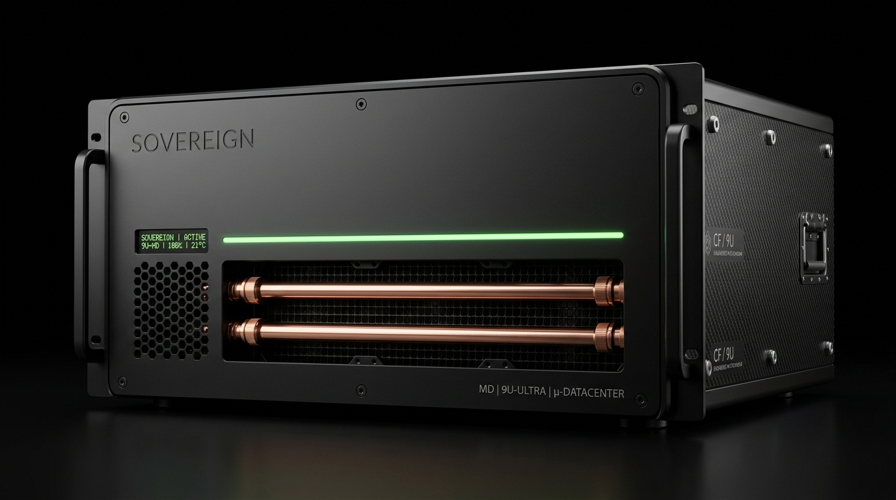
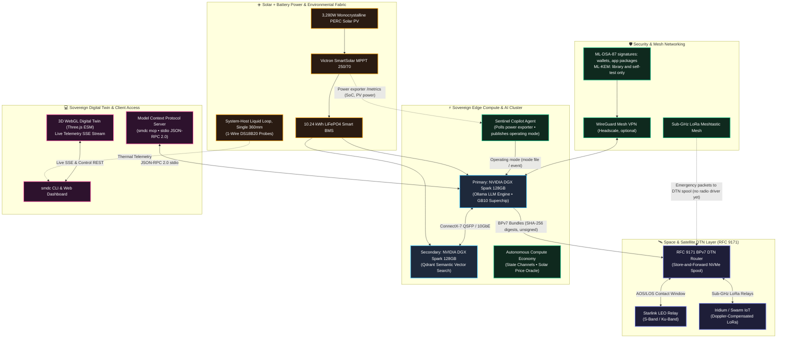

# Sovereign Mini Datacenter



**Sovereign Mini Datacenter** is a self-powered, solar-backed micro-datacenter stack with air-cooled AI nodes and a liquid-cooled host, designed for **complete data and computational sovereignty**. Run your own private AI with semantic RAG, Git hosting, project management, file cloud, email server, password vault, and private WireGuard mesh VPN — fully off-grid capable.

Developed by **[Metatopia Studio](https://metatopia.gr)** · Author & Lead Architect: **[Ilias Chrysovergis](https://iliachry.gr)** · License: MIT · © 2026

[](https://github.com/iliachry/sovereign-mini-datacenter/actions/workflows/ci.yml)
[-10b981?style=flat&logo=githubactions)](https://github.com/iliachry/sovereign-mini-datacenter/actions/workflows/ci.yml)
[](ENTERPRISE_ONBOARDING.md)
[](COMMERCIALIZATION.md)
[](BENCHMARKS.md)
[-ec4899?style=flat)](COMPLIANCE.md)
[](terraform/README.md)
[](https://iliachry.gr/sovereign-mini-datacenter/)
[](AGENTS.md)
[](ARCHITECTURE.md)

---

## 💼 Investor, Enterprise & Defense Dossier

| Resource | Scope & Key Takeaways | Link |
| :--- | :--- | :---: |
| **🏢 Enterprise Onboarding & SDK** | Vendor-neutral manifest (`smdc-app.yaml`), zero-dependency SDK, power tiers ($L_0 \to L_4$), and PQC packaging | [**`ENTERPRISE_ONBOARDING.md`**](ENTERPRISE_ONBOARDING.md) |
| **📈 Commercial Strategy & TCO Model** | Market Sizing (\$60.4B TAM), Unit Economics, 5-Year Financials, **7.0 Mo Payback & 67.8% TCO Savings** in the TCO-table scenario (vs. a cloud + diesel alternative with \$12,000 capex and about \$3,000/month of running costs); the website calculator's default scenario (\$2,500/month of cloud spend plus grid energy at \$0.35/kWh, no capex on the alternative side) gives 13.0 months | [**`COMMERCIALIZATION.md`**](COMMERCIALIZATION.md) |
| **🏗️ Terraform & OpenTofu IaC** | Bare-metal Talos Linux, Proxmox VE GPU passthrough, WireGuard mesh, and automated Helm bootstrapping | [**`terraform/README.md`**](terraform/README.md) |
| **⚡ Benchmarks: Measured vs. Design Targets** | Measured on a development machine (Mac mini M4, 2026-11-14): 18.9 to 19.5 tokens/s for `qwen2.5-coder:7b` on Ollama, about 2,100 DTN bundles/s into the spool, and the load-shedding software path in simulation. No run on the DGX Spark reference hardware is documented, and Qdrant latency has not been measured; hardware reaction times and link figures are labelled design targets | [**`BENCHMARKS.md`**](BENCHMARKS.md) |
| **🛡️ Security Controls & Compliance Mapping** | Self-assessment, not a certification: which controls ship today (edge TLS, optional WireGuard VPN, encrypted backups, ML-DSA signatures) and which are planned (mutual TLS, TPM-sealed keys, Secure Boot, encrypted DTN bundles), mapped to SOC 2, ISO 27001 and NIST 800-53 | [**`COMPLIANCE.md`**](COMPLIANCE.md) |
| **🌐 Interactive Digital Twin & ROI Simulator** | 3D WebGL CAD visualizer, live subsystem explorer, and **interactive investor TCO calculator** | [**Live 3D WebGL Viewer**](https://iliachry.gr/sovereign-mini-datacenter/) |
| **🏛️ Autonomous Sovereign Mesh Architecture** | 7-Layer protocol stacks, multi-spectral communication fabric, delay-tolerant space networking (RFC 9171) | [**`ARCHITECTURE.md`**](ARCHITECTURE.md) |

---

## 🌐 Live Interactive 3D Viewer & TCO Simulator

Inspect the 9U 19" chassis, rails, liquid-cooling loop, space DTN antenna, and run live TCO/payback calculations:
👉 **[Open 3D WebGL CAD Viewer & ROI Simulator](https://iliachry.gr/sovereign-mini-datacenter/)**

---

## 🏛️ System Architecture



---

## 📁 Repository Layout

```
sovereign-mini-datacenter/
├── src/
│   └── sovereign_dc/            # Python CLI & Core Stack Package (`smdc`)
│       ├── __init__.py          # Version & package metadata
│       ├── cli.py               # Unified CLI interface (argparse)
│       ├── config.py            # Layered configuration (Defaults -> YAML -> Env)
│       ├── events.py            # In-process thread-safe pub/sub event bus
│       ├── log.py               # Structured JSON & colored logging
│       ├── hal/                 # Hardware Abstraction Layer (GPU, Power, Storage, Thermal)
│       ├── agents/              # Agent workers (Sentinel mode publisher, Indexer, CodeReviewer)
│       ├── enterprise/          # Enterprise Workload Onboarding & Coupling Framework
│       │   ├── schema.py        # Declarative manifest dataclass & validation (smdc-app.yaml)
│       │   ├── registry.py      # App discovery, registry persistence & scaffolding
│       │   ├── sdk.py           # Zero-dependency SMDCClient & AppLifecycleHandler SDK
│       │   └── manager.py       # App state tracking (no process supervision), load-shedding hooks & PQC packaging
│       ├── economy/             # Monetary & Compute Economy (Wallets, Ledger, State Channels, Dynamic Pricing)
│       ├── mcp/                 # Native Model Context Protocol Server (2024-11-05 JSON-RPC 2.0)
│       ├── mesh/                # Multi-node WireGuard, LoRa & Chaos engineering simulator
│       ├── security/            # NIST FIPS 203/204 Post-Quantum Cryptography (ML-KEM, ML-DSA)
│       ├── space/               # Space DTN routing (RFC 9171) & simplified orbital pass predictor
│       ├── telemetry.py         # Power & thermal Prometheus exporter (simulation)
│       └── web/                 # Real-time Web Operations Dashboard & REST API
├── examples/                    # Turnkey Enterprise Reference Applications
│   └── enterprise_apps/         # Starter templates for rapid edge onboarding
│       ├── iot-edge-gateway/    # L0 critical IoT gateway skeleton (simulated sensors)
│       ├── edge-vision-ai/      # L2 background vision skeleton (simulated inference, no GPU code)
│       ├── spatial-digital-twin/# L1 standard digital-twin skeleton (placeholder figures)
│       └── confidential-vault/  # L0 critical secrets-vault skeleton (stores and encrypts nothing)
├── software/
│   ├── docker-compose.yml       # Sovereign Core 12-service production stack
│   ├── Dockerfile.smdc          # Multi-arch container image (linux/amd64, linux/arm64)
│   ├── setup.sh                 # Modular deployment CLI (--all, --with-vpn, etc.)
│   ├── env.example              # Environment configuration template
│   ├── prometheus.yml           # Prometheus scrape configuration (Node, Space, ESP32, LoRa)
│   ├── agents/                  # AI Knowledge Indexer & Code Reviewer daemons
│   ├── mesh/                    # WireGuard mesh & LoRa Meshtastic packet gateway
│   ├── vpn/                     # WireGuard Mesh VPN (Headscale)
│   ├── backup/                  # Encrypted Backup & Recovery (Restic)
│   ├── telemetry/               # Power exporter (Prometheus) & load_shedder.sh host script
│   ├── space/                   # Space & Satellite Communications (DTN / BPv7)
│   ├── mailcow/                 # Sovereign Email Stack
│   └── grafana/
│       └── provisioning/        # Auto-provisioned dashboards (Power, Thermal, Space)
├── kubernetes/
│   └── helm/
│       └── sovereign-stack/     # Production Helm chart (K3s/Talos AI & Telemetry cluster)
├── firmware/
│   ├── esp32_telemetry_bridge.ino # Arduino C++ ESP32 firmware (VE.Direct, DS18B20, HTTP /metrics)
│   └── esphome_smdc_bridge.yaml   # ESPHome firmware with MQTT discovery & metrics
├── hardware/
│   ├── COMPONENTS.md            # Full Bill of Materials with pricing & electrical specs
│   └── WIRING_DIAGRAM.md        # DC/AC electrical, liquid cooling & network schematics
├── cad/
│   ├── rack_enclosure.scad      # Parametric OpenSCAD 9U 19" chassis model
│   ├── accessories.scad         # 3D printable DIN rails, Jetson mounts, OLED bezels
│   ├── MANUFACTURING_GUIDE.md   # Laser cut, CNC bend, and assembly instructions
│   └── render.jpg               # Photorealistic 3D product render
├── docs/                        # Interactive Three.js WebGL Digital Twin (ES Modules) & GitHub Pages
├── tests/                       # 1337 automated unit & integration tests (92.5% coverage)
└── .github/
    └── workflows/
        ├── ci.yml               # Complete CI pipeline + Pytest + GitHub Pages deploy
        └── release.yml          # Automated PyPI package release pipeline
```

---

## 🐍 Python CLI Package (`smdc`)

Manage the datacenter, live telemetry, space communications, autonomous AI agents, and the host hardening audit directly from your terminal:

```bash
pip install sovereign-dc
# or with uv:
uv tool install sovereign-dc
```

```bash
# Check container health, solar power, and space link telemetry
smdc status

# Launch real-time Web Operations Dashboard & REST API
smdc dashboard --port 8080

# Inspect the node wallet (Ed25519 & NIST PQC ML-DSA-87). One wallet and one ledger per node:
# the CLI, the dashboard and the MCP server report the same address and balance. A new
# node starts at 0 credits; no command mints implicitly.
smdc economy wallet

# Mint LOCAL TEST credits to the node wallet (issued by this node for itself: no external value)
smdc economy mint 100 --memo "local test"
smdc mint 100 --memo "local test"                    # Same command, top-level shortcut

# Query dynamic solar-aware compute & relay price quotes
smdc economy market --soc 85 --solar 1200

# Transfer compute credits between sovereign nodes
smdc economy send <recipient_address> 25.0 --memo "LLM_INFERENCE_BATCH"

# Run the host hardening audit (Linux: kernel settings, Docker exposure, firewall, .env hygiene)
smdc audit

# Post-quantum cryptographic operations (NIST FIPS 203/204)
smdc security pqc --help

# Mesh chaos engineering & resilience simulations
smdc mesh chaos --help

# Autonomous AI Agent operations
smdc agent status                                    # Check that Ollama and Qdrant are reachable
smdc agent ask "How do I throttle background jobs?" # Send a prompt to the local Ollama model
smdc agent review patch.diff                         # AI code review on local git diff
smdc agent index /data/docs                          # Index a directory into Qdrant (same file set as the indexer worker)

# Enterprise Workload Onboarding & Lifecycle Management
smdc app list                                        # List all registered enterprise apps & runtime state
smdc app init "IoT Edge" --app-id iot-edge --category iot --target-dir ./iot-edge # Scaffold new app repo
smdc app init "IoT Edge" --app-id iot-edge --target-dir ./iot-edge --force # Re-scaffold: without --force init refuses if a scaffold file exists; with it each existing file is first moved to <name>.bak-<timestamp>
smdc app validate ./iot-edge                         # Validate smdc-app.yaml schema and resource quotas
smdc app register ./iot-edge                         # Register app on local sovereign node
smdc app start iot-edge                              # Mark the app running, or paused if load shedding currently pauses its tier (state tracking; no process is launched)
smdc app status iot-edge                             # Show tracked state (resource figures are manifest estimates)
smdc app package ./iot-edge --output iot-edge.smdc-app # Package & sign with NIST FIPS 204 ML-DSA-87
smdc app verify iot-edge.smdc-app --public-key <hex-or-file> # Check archive digest, size and signature against a signer key you trust (exit 1 if not verified; nothing runs this for you)
smdc verify iot-edge.smdc-app --public-key <hex-or-file>     # Same command, top-level shortcut

# Inspect multi-node global mesh cluster topology
smdc mesh

# Predict upcoming satellite contact passes (AOS / TCA / LOS)
smdc space passes --hours 12

# Inspect real-time space link budget, SNR, and Doppler shift
smdc space status

# Queue a bundle in the DTN spool for the next contact pass (the payload is not encrypted)
smdc space send dtn://ground-station-alpha.earth/telemetry "STATUS_OK" --priority 2

# Inspect DTN store-and-forward spool queue
smdc space queue

# Deploy all container stacks (Core, VPN, Backup, Telemetry, Space, Agents, Security)
smdc deploy --all
```

> **Dashboard access (`smdc dashboard`)**: the server binds `127.0.0.1` unless `--host` or `SMDC_DASHBOARD_HOST` says otherwise. Set `SMDC_DASHBOARD_TOKEN` before exposing it: control POSTs then require `Authorization: Bearer <token>`, and so do the JSON and SSE read endpoints for any non-local client (the SSE stream also accepts `?token=`); without a token, control POSTs are accepted only from a local, non-proxied client (loopback TCP peer and no `X-Forwarded-For` / `Forwarded` / `X-Real-IP` / `Via` header), so neither a remote client nor one relayed by a same-host reverse proxy can control the node, but both can still read `/api/status`. **DNS-rebinding defence:** a request counts as local only if its `Host` header names a loopback host (`localhost`, `127.0.0.0/8`, `[::1]`) or a name listed in `SMDC_DASHBOARD_ALLOWED_HOSTS` (comma-separated host names, for a node you open by name, e.g. `SMDC_DASHBOARD_ALLOWED_HOSTS=smdc.lan,node1.example.org`). A request whose `Host` is neither of those nor the bound address (on a wildcard bind such as `0.0.0.0`: any IP literal) is served the JSON and SSE endpoints only with a valid token; without one, reads get HTTP 421 and control POSTs 403 when no token is configured, and both get 401 when a token is configured. So reach a tokenless node by IP address or list its name; `/health` and the page itself stay open. The rack-door and PDU-outlet controls change a **digital shadow** only: this package ships no door or PDU driver, so their responses and the `hardware` section of `/api/status` say `"actuated": false, "simulated": true`, and in hardware mode (`HAL_MODE=hardware`) they are refused with HTTP 501 until an integration registers an actuator backend (`sovereign_dc.web.dashboard.register_actuator`). `hardware.fan_rpm` is an estimate from coolant temperature and load (`"fan_rpm_estimated": true`), not a tachometer reading, and a quantity the telemetry source did not report is `null`, never a nominal value. Browser pages from other origins get no CORS access unless they are loopback origins or listed in `SMDC_CORS_ORIGIN` (comma-separated origins, or `*`), for example `SMDC_CORS_ORIGIN=https://iliachry.gr` to let the hosted 3D twin shadow a node opened as `?node=<node url>&token=<token>`.

> **State and configuration**
> - **`SMDC_STATE_DIR`** (default `~/.smdc`, mode 0700) holds wallets, ledgers, node keys and, by default, the DTN spool `dtn_spool.db` (override: `DTN_DB_PATH`), the technician alert log `sovereign_logs/technician_notifications.jsonl` (override the directory: `SOVEREIGN_LOG_DIR`) and the sentinel mode file `sovereign_mode` (override: `SOVEREIGN_MODE_FILE`). Nothing defaults to shared `/tmp` any more. A spool left by an older release at `/tmp/dtn_spool.db` keeps being used until `<state dir>/dtn_spool.db` exists, but only if it is a regular file owned by you and not group/world-writable; move it into the state directory to keep it across reboots.
> - **DTN submission** (`POST /api/control/dtn-transmit`): `destination`, `payload` (text) or `payload_b64` (base64 binary), `ttl` (seconds; default 7 days, capped at 30), `priority` (0 bulk, 1 normal, 2 expedited, 3 critical) and optional `source` endpoint ID.
> - **Knowledge indexer**: `DOCS_WATCH_DIR` (directory to index), `DOCS_INCLUDE_GLOB` (comma-separated globs relative to it; empty = everything, the agents overlay uses `*/files/**` for Nextcloud user files), `DOCS_EXCLUDE_DIRS` (directory names never entered; default `appdata_*,files_trashbin,files_versions,files_external,cache,uploads,.*`) and `DOCS_MAX_FILE_BYTES` (default 5 MiB; larger files are skipped). Qdrant point ids are UUIDs; points stored under the integer ids of earlier releases are replaced when their document is re-indexed.
> - **Sentinel**: `SENTINEL_POLL_INTERVAL_SECONDS` (seconds between polls of the power exporter; default 30, minimum 1; an invalid value is ignored with a warning). The agents overlay passes it through from `.env`.
> - **Load-shedding policy**: `SHEDDING_L1_SOC`, `SHEDDING_L2_SOC`, `SHEDDING_L3_SOC`, `SHEDDING_L4_SOC` (battery SoC in percent below which shedding levels 1 to 4 start; defaults 50, 30, 20, 10) are read by the CLI, the dashboard, the MCP server, the sentinel, the power exporter (`SHEDDING_L3_SOC`) and `load_shedder.sh`. They must be numbers within 0–100 with L1 > L2 > L3 > L4: otherwise the Python components log one warning and use all four defaults, and `load_shedder.sh` exits 2. `SHEDDING_HYSTERESIS_SOC` (default 2, range 0–10) is how many points above a level's threshold the SoC must be before the sentinel leaves that level again.
> - **Node identity**: `NODE_ID` (default `smdc-dgx-01`) names the node everywhere; the DTN router's default endpoint id is `dtn://<NODE_ID>.sovereign.space` unless `DTN_LOCAL_EID` is set.
> - **Backup**: `BACKUP_POLL_SECONDS` (default 300) is how often the `sovereign_backup` container looks for a dump generation that is not in the repository yet (each generation is uploaded once); it is not the backup interval, which is the schedule of the host job `backup.sh --dump-only` (`BACKUP_INTERVAL_SECONDS` is no longer read). `BACKUP_NEXTCLOUD_MODE` is `maintenance` (default: Nextcloud is in maintenance mode while its database is dumped and its volume copied) or `online` (no downtime; the files may not match the database). All backup variables: [`software/backup/README.md`](software/backup/README.md).
> - **Hardware telemetry**: `ESP32_BRIDGE_URL` (the `/metrics` URL of the ESP32 bridge, read when `SIMULATE_POWER_DATA=false`). **Dashboard**: `SMDC_DASHBOARD_ALLOWED_HOSTS` (host names under which the node may be opened without a token; see the dashboard note above).
> - **Mesh topology**: `CLUSTER_CONFIG_PATH` names the cluster YAML that `load_peers()` in `mesh_sync.py` reads; unset, it looks for `cluster_config.yaml` next to `mesh_sync.py` (the repository ships one at `software/mesh/cluster_config.yaml`) and otherwise uses the built-in three-site reference topology.
> - **SQLite state files** (ledgers, DTN spool) are created with mode 0600; an existing file owned by you with a wider mode is tightened to 0600 the next time it is opened.
> - **Standalone overlay**: to run one overlay against a core stack that is already up, add the attach file: `docker compose --project-directory software -f software/docker-compose.attach.yml -f software/agents/docker-compose.agents.yml up -d` (add `-p <name>` if the core stack does not use the default project name `software`).


---

## 🏛️ Advanced Capabilities & Pillars

### 1. 🤖 Autonomous Local AI Agents (`software/agents/`)
* **Nextcloud Knowledge Indexer:** Worker that polls `DOCS_WATCH_DIR` every 30 s, reads plain-text files (`.md`, `.txt`, `.csv`, `.json`, `.py`, `.sh`; it does not extract text from PDF or Office documents), splits them into chunks, embeds each chunk via Ollama (`nomic-embed-text`) and stores the vectors in the Qdrant collection `sovereign_knowledge`. It defers indexing while the sentinel mode is `ECO_PRESERVATION` or `CRITICAL_SHEDDING`.
* **GitLab Automated Code Reviewer:** Polling worker (every 60 s; there is no webhook) that lists open Merge Requests through the GitLab API, sends the first 4,000 characters of each diff to a local model (`qwen2.5-coder`) and posts one summary note per MR revision (not inline comments). Without `GITLAB_API_TOKEN` it reviews nothing.
* **Datacenter Sentinel Copilot:** Rule-based worker (no LLM) that polls the power exporter every `SENTINEL_POLL_INTERVAL_SECONDS` (default 30), maps battery state of charge to a shedding level 0–4 (below 50 / 30 / 20 / 10 %, `SHEDDING_L1_SOC`..`SHEDDING_L4_SOC`) and to an operating mode (`NORMAL`; `SOLAR_SURPLUS_COMPUTE` at level 0 with PV power above 1000 W and SoC above 75 %; `ECO_PRESERVATION` from level 2), leaves a level only once SoC is `SHEDDING_HYSTERESIS_SOC` points (default 2) above its threshold so that a hovering SoC does not toggle it, writes that mode to the shared mode file and publishes a `load_shedding.changed` event with mode, level and SoC on the in-process event bus. Its clear-sky time-of-day estimate (not a weather forecast) is only logged. It does not schedule, throttle or stop workloads itself: the knowledge indexer reads the mode file and defers indexing, and an `EnterpriseManager` running in the same process marks apps paused by power tier (state tracking only; table in [`ENTERPRISE_ONBOARDING.md`](ENTERPRISE_ONBOARDING.md), section 3).

### 2. 🔌 ESP32 Microcontroller Hardware Bridge (`firmware/`)
* C++ Arduino and ESPHome firmware reading physical **Victron VE.Direct** serial streams (checksum-validated) and **DS18B20 1-Wire** coolant temperature probes, broadcasting via HTTP `/metrics` (and MQTT in the ESPHome flavour). RS485 Modbus BMS reading is not implemented.
* **Bridge → stack:** the power exporter is the hardware reader. With `SIMULATE_POWER_DATA=false` (or `smdc telemetry --hardware`) and `ESP32_BRIDGE_URL=http://<bridge-ip>/metrics` it scrapes either firmware flavour on every request and re-exports the readings under the canonical `sovereign_*` names that the HAL, the sentinel, `load_shedder.sh` and Grafana read (mapping table in [`firmware/README.md`](firmware/README.md)). A series the bridge does not supply is omitted, and `sovereign_telemetry_source_up` is `0` when the bridge is unreachable, returns nothing usable, or its last valid VE.Direct frame is older than `ESP32_BRIDGE_MAX_FRAME_AGE_SECONDS` (default 10). VE.Direct and RS485 are not read directly by the node, and the path has only been tested against the firmware's output format, not against a physical bridge.

### 3. 🛡️ Security Hardening & Intrusion Detection (`software/security/`)
* **CrowdSec Intrusion Detection:** CrowdSec reads the Traefik access log and raises decisions for brute-force scanners and malicious IP ranges. No bouncer is wired yet, so it detects but does not block.
* **Access-log rotation (host job):** Traefik writes its access log to the `sovereign_traefik_logs` volume whether or not CrowdSec is deployed, and does not rotate it. Install the logrotate rule once on the Docker host, or the file grows until the disk is full: `sudo install -m 0644 software/security/traefik-access-log.logrotate /etc/logrotate.d/sovereign-traefik` (it rotates daily or above 100 MB, keeps 14 files and sends Traefik `USR1` to reopen the log; the file's header explains how to test it).
* **`smdc audit` Scanner:** Reports host kernel sysctl parameters, Docker socket exposure, privileged containers, host firewall state and `.env` file hygiene (Linux only; it does not check TLS configuration and changes nothing).
* **What is and is not implemented:** [`COMPLIANCE.md`](COMPLIANCE.md) lists every security control with its status. In short: HTTPS at the edge, an optional WireGuard VPN, encrypted backups and ML-DSA signatures exist; mutual TLS, single sign-on, TPM-sealed disk keys, Secure Boot and encrypted DTN bundles are planned and not implemented. The project holds no SOC 2, ISO 27001 or FIPS certification.

### 4. 🧮 Interactive 3D Sizing & Cost Configurator
* Live WebGL sizing calculator on **[https://iliachry.gr/sovereign-mini-datacenter/](https://iliachry.gr/sovereign-mini-datacenter/)** simulating daily kWh draw, solar harvest, zero-sun battery autonomy, and dynamic BOM cost with one-click CSV export.

### 5. 🌐 Multi-Node Sovereign Mesh (`software/mesh/`)
* **Peer reachability monitor (`mesh_sync.py`):** loads the peer list from the cluster YAML and probes each OTHER peer's exporter (`http://<wireguard_ip>:9101/metrics`; every peer except the node's own `NODE_ID`, default `smdc-dgx-01`) once per `MESH_POLL_INTERVAL_SECONDS`, logging which peers answer. It transfers no data: state, repository and backup synchronisation between sites is not implemented.
* **LoRa gateway (`lora/`):** Meshtastic packet gateway configuration (no radio driver ships with this repository).

### 6. 💰 Autonomous Monetary & Compute Economy Layer (`src/sovereign_dc/economy/`)
* **Post-Quantum Cryptographic Wallets:** Deterministic address derivation and signing using Ed25519 and NIST FIPS 204 ML-DSA-87.
* **Append-Only Compute Credit Ledger:** Monotonically increasing nonces, transaction hashes, and offline unidirectional micro-payment state channels (one payer, one payee per channel) for streaming compute.
* **Solar-Aware Dynamic Price Oracle:** Energy-state multiplier on every catalog rate: a 50% discount while solar harvest is at least 500 W and battery SoC at least 75%, nominal pricing down to 40% SoC, a 1.5x surge below 40% SoC and a 3.0x surge below 25% SoC. (This is the pricing rule; the sentinel's `SOLAR_SURPLUS_COMPUTE` operating mode has its own bar of more than 1000 W.)
* **Delay-Tolerant Settlement:** Cryptographic Proof-of-Compute and Proof-of-Relay verification reconciled across terrestrial mesh or RFC 9171 DTN satellite contact passes.

### 7. 🏢 Generic Enterprise Workload Coupling Framework (`src/sovereign_dc/enterprise/`)
* **Declarative Manifests (`smdc-app.yaml`):** Standardized specification defining CPU/GPU/storage quotas, network bindings, persistent NVMe volumes, and power shedding tiers ($L_0 \to L_4$).
* **Zero-Dependency SDK (`sovereign_dc.enterprise.sdk`):** Lightweight client library for querying node telemetry, publishing custom application metrics, listening for load-shedding pause and resume signals, and spooling space DTN bundles.
* **Post-Quantum Cryptography Packaging:** Bundling of edge applications into `.smdc-app` archives signed with ML-DSA-87 (the FIPS 204 algorithm, from a pure-Python library that is not FIPS-validated). `smdc app verify` checks a package against a signer public key you supply; there is no installer, so nothing verifies a package unless you run it.
* **Reference Archetypes (`examples/enterprise_apps/`):** Simulated reference skeletons (manifest plus an `app.py` that shows the SDK wiring and publishes placeholder data; none of them reads a sensor, runs a model, encrypts data or controls a radio) for IoT edge gateways, GPU vision AI inference, spatial digital twins, confidential databases, and O-RAN Near-RT RIC controllers. See [**`ENTERPRISE_ONBOARDING.md`**](ENTERPRISE_ONBOARDING.md) for full developer documentation.

### 8. 📡 5G RAN & UAV Metaverse Simulation Stack (`src/sovereign_dc/metaverse/`)
* **Physics-Based Electromagnetic Ray-Tracing:** 3GPP UMi & Sionna 3D multipath propagation at 3.5 GHz ($23\text{ dBm}$ TX, $+8\text{ dBi}$ gain) with up to 5th-order reflections and Kriging spatial interpolation.
* **Scene-Aware Reinforcement Learning (SA-PPO):** 3-layer Actor-Critic neural agent optimizing 3D UAV positioning ($\pm X, \pm Y, \pm Z$) (the published paper reports a $+79.6\%$ capacity boost on the disadvantaged receiver; this repository's simplified simulator does not reproduce that figure and its SA-PPO vs MD-PPO result varies with the random seed).
* **5G Network Slicing & SDN:** Mathematical bandwidth isolation ($T_{\mathrm{tx}} = (D \cdot 8)/B_{\mathrm{slice}} \cdot 1000\text{ ms}$) managing URLLC ($<1\text{ ms}$), eMBB ($127\text{ Mbps}$), and mMTC ($12\text{k devs/km}^2$).
* **DePIN Blockchain SLA & Consensus:** Multi-validator PoS/dBFT consensus requiring $\lfloor 2N/3 \rfloor + 1$ multi-signatures with $-15\text{ dB}$ minimum SINR rejection thresholds and $<6\text{ ms}$ critical-path deadlines.

---

## 🚀 Quick Start

### 1. Clone & Configure

```bash
git clone https://github.com/iliachry/sovereign-mini-datacenter.git
cd sovereign-mini-datacenter/software

# Copy template and fill in your domain names and secrets
cp env.example .env && nano .env
```

### 2. Deploy via Modular CLI

```bash
# Option A: Core stack plus every overlay: Headscale VPN, Restic backup, telemetry exporter,
#           space/DTN node, AI agents and CrowdSec (detection only). Mailcow is a separate
#           stack and is not deployed (--with-mailcow prints its manual steps).
sudo bash setup.sh --all

# Option B: Deploy Core Stack only
sudo bash setup.sh

# Option C: Deploy Core Stack with Mesh VPN and Automated Backup
sudo bash setup.sh --with-vpn --with-backup

# Option D: Dry-run configuration test
bash setup.sh --dry-run
```

---

## 📦 Services Catalog

All web services are securely routed over **HTTPS** via Traefik with automatic Let's Encrypt TLS:

| Service | Default URL | Purpose |
|:--|:--|:--|
| 🤖 **Open-WebUI** | `https://ai.yourdomain.com` | Private ChatGPT-style interface with local RAG |
| 🦙 **Ollama API** | Internal (`:11434`) | GPU-accelerated local LLM inference engine |
| 🧠 **Qdrant** | Internal (`:6333`) | High-performance vector database for document embeddings |
| 🦊 **GitLab CE** | `https://gitlab.yourdomain.com` | Self-hosted Git repositories & CI/CD pipelines |
| 📋 **OpenProject** | `https://projects.yourdomain.com` | Project tracking, Gantt charts, and task management |
| ☁️ **Nextcloud** | `https://cloud.yourdomain.com` | File sync (HTTPS in transit), calendar, and office suite |
| 🔐 **Vaultwarden** | `https://vault.yourdomain.com` | Bitwarden-compatible password manager |
| 📬 **Mailcow** | `https://mail.yourdomain.com` | Sovereign email stack (SOGo Webmail + Postfix/Dovecot) |
| 🛡️ **Headscale VPN** | `https://vpn.yourdomain.com` | Self-hosted WireGuard mesh VPN control plane |
| 📊 **Grafana** | `https://grafana.yourdomain.com` | Infrastructure, container, power & thermal dashboards |
| 📈 **Prometheus** | `https://metrics.yourdomain.com` | Time-series metrics aggregator (HTTP Basic Auth protected) |
| 🔀 **Traefik** | `https://traefik.yourdomain.com` | Reverse proxy edge router & dashboard |

---

## 🛡️ Sovereign Remote Mesh VPN (Headscale)

Connect phones, laptops, and remote workstations securely without public port-forwarding:

```bash
# 1. Create a user
./software/vpn/register-node.sh create-user admin

# 2. Generate a 90-day pre-authenticated key
./software/vpn/register-node.sh create-authkey admin --reusable --expiration 90d

# 3. Connect client devices
tailscale up --login-server https://vpn.yourdomain.com --authkey <AUTH_KEY>
```

See [`software/vpn/README.md`](software/vpn/README.md) for full configuration details.

---

## 💾 Encrypted Backup & Disaster Recovery (Restic)

- **Repository:** restic snapshots in `RESTIC_REPOSITORY` (default `/var/backups/sovereign`); use a remote backend (`s3:`, `sftp:`, `rest:`) or copy the repository off-site, because a repository on the node's own disk does not survive the loss of the node.
- **Deduplicated & Encrypted:** restic encrypts the repository with AES-256; `restore.sh check` (`restic check`) verifies the archive only.
- **Databases are backed up as native dumps, never as copies of live directories:** `pg_dump` for OpenProject, `gitlab-backup create` for GitLab and the SQLite online backup (`sqlite3 ... ".backup"`) for Vaultwarden, Nextcloud, Headscale, Grafana, Open WebUI, CrowdSec and the DTN spool. If any dump fails, the run stops before restic is called and no snapshot is taken.
- **Host requirements:** root on the Docker host, `docker`, `sqlite3` and `restic`; `RESTIC_PASSWORD` must be set in `software/.env` (there is no default).
- **With `--with-backup`:** the `sovereign_backup` container only uploads; the dumps still come from the host. Schedule `backup.sh --dump-only` there (root crontab or systemd timer), otherwise every container run fails and uploads nothing.

```bash
# Run an immediate backup on the host (dump every database, then restic)
sudo sh software/backup/backup.sh

# Host dump phase only: schedule this before the sovereign_backup container's run (--with-backup)
sudo sh software/backup/backup.sh --dump-only

# Prove that the dumps in the newest COMPLETE snapshot load (SQLite integrity_check, pg_restore --list, GitLab archive listing)
sudo bash software/backup/restore.sh --verify

# List the snapshots and whether each is complete, incomplete (a failed run) or unclassified
sudo bash software/backup/restore.sh list

# Disaster recovery: extract the newest complete snapshot into an EMPTY directory (never a live volume), then print the per-service restore steps
sudo bash software/backup/restore.sh restore-latest /mnt/restore_target
sudo bash software/backup/restore.sh plan /mnt/restore_target
```

`restore.sh` needs `restic` on the host. A snapshot is complete when `backup.sh` tagged it `sovereign-complete` after a clean run; a snapshot of a run in which restic could not read every file is tagged `sovereign-incomplete`, is never picked automatically (`restore.sh restore-id <id> <target>` restores it on request) and does not count in the retention policy. With `--with-backup` the repository is the container's `backup_storage` volume, not the host directory `/var/backups/sovereign`: `restore.sh` finds the volume through `docker volume inspect` and stops if both places hold a repository.

See [`software/backup/README.md`](software/backup/README.md) for what a snapshot contains, cron scheduling, which repository `restore.sh` reads (and how to run it inside a container) and the per-service restore procedures. `restore.sh --verify` is not a substitute for a restore rehearsal on a spare node.

---

## ☀️ Power, Solar & BMS Telemetry

- **Real-time Metrics:** Collects solar PV generation, LiFePO4 battery pack SoC %, DC bus voltage, current, and coolant temperatures.
- **Load-Shedder (one pass per run, from cron or a systemd timer):** If battery SoC drops below 20% (`SHEDDING_L3_SOC`, shedding level 3) or coolant exceeds 60°C, `software/telemetry/load_shedder.sh` records a shed decision. With `LOAD_SHED_ACTION=pause` it runs `docker pause` on `LOAD_SHED_CONTAINER` (default `sovereign_ollama`) and records the cause(s). It unpauses only after every cause recorded at pause time has verifiably cleared: SoC back to 50% or more (`SHEDDING_L1_SOC`, shedding level 0) for a low-battery pause; a present coolant reading at or below 55°C for an overheating pause. A missing reading holds the pause, and so does an unknown container state: while `docker inspect` fails the pause marker is kept, and the container is resumed once Docker answers again. The default, `LOAD_SHED_ACTION=log`, only logs the decision and never pauses or resumes anything.

---

## 🧪 1-Click Local Demo Sandbox & CLI Benchmarking

Run the complete Sovereign Mini Datacenter stack on any standard laptop without physical hardware:

```bash
# Launch the 1-click live demonstration sandbox
./software/demo.sh                # Linux / macOS / WSL
smdc demo --steps 5               # Cross-platform CLI

# Run the local benchmarks (synthetic CPU vectors, DTN spool, memory, load-shedding software path)
smdc benchmark --all --export benchmark_results.json

# Measure the load-shedding software path in simulation on this machine (median / p95 over N runs):
# telemetry sample -> sentinel mode decision -> deferrable apps marked paused. No hardware actuation.
smdc benchmark --shed --shed-iterations 200

# Measure real LLM token throughput against a running Ollama server
smdc benchmark --ai --live --model qwen2.5-coder:7b

# Verify the compute ledger chain and anchor its head with the node identity key
smdc economy audit --anchor

# Run 5G Metaverse simulation cycles & DePIN SLA validation
smdc sim run --cycles 5
smdc sim slices
smdc sim sla
smdc sim benchmark --episodes 5 --steps 10

# Simulate decentralized Raft leader election across 4 swarm nodes
smdc mesh consensus --nodes 4
```

---

## 🛠️ Developer Automation & Quality Gates

A unified developer task runner, fast inner-loop test suite, and pre-flight environment inspector:

```bash
# 1. One-shot developer environment bootstrap
./scripts/setup_dev.sh            # Linux / macOS / WSL
.\scripts\setup_dev.ps1           # Windows PowerShell

# 2. Run system pre-flight readiness diagnostics
smdc doctor

# 3. Serve 3D WebGL Digital Twin locally (Port 8088) with auto-browser launch
smdc docs --serve --port 8088

# 4. Cross-Platform Developer Task Runner
make check                        # Linux/macOS: format + lint + types + fast tests
.\scripts\dev.ps1 check           # Windows: format + lint + types + fast tests

make test-fast                    # Fast tests without coverage
make test-subsystem SUB=cli       # Target specific subsystem tests
make serve-twin                   # Serve 3D Digital Twin locally
make dashboard                    # Launch Web Operations Dashboard
```

> **💡 IDE Integration**: Native `.vscode/tasks.json` maps `Ctrl+Shift+B` to `Fast Check (Lint + Types + Fast Tests)`. Pre-configured `launch.json` debug profiles are included for `smdc doctor`, `smdc dashboard`, `smdc demo`, and active Pytest test files.

---

## ☸️ Kubernetes & GitOps Deployment (Helm / K3s / Talos)

Deploy the Sovereign stack onto edge Kubernetes clusters (K3s, Talos, MicroK8s):

```bash
# 1. Inspect the sovereign-stack Helm chart
helm lint kubernetes/helm/sovereign-stack

# 2. Deploy AI cluster & telemetry to your sovereign namespace
helm upgrade --install sovereign-stack ./kubernetes/helm/sovereign-stack \
  --namespace sovereign \
  --create-namespace \
  --values kubernetes/helm/sovereign-stack/values.yaml
```

---

## 🏗️ Terraform & OpenTofu Infrastructure-as-Code (`terraform/`)

Automate bare-metal Talos Linux OS provisioning, Proxmox VE GPU passthrough, WireGuard mesh, and Helm bootstrapping:

```bash
# Deploy bare-metal Talos cluster & Sovereign Helm stack
cd terraform/environments/baremetal-talos
tofu init
tofu apply -auto-approve

# Or spin up a virtualized Proxmox VE GPU edge testbed
cd terraform/environments/proxmox-dev
tofu init
tofu apply -auto-approve
```

See [`terraform/README.md`](terraform/README.md) for full module documentation and input variable references.

---

## 🛡️ Quality Gates & Automated Tests
The project enforces strict automated Quality Gates covering Ruff linting, Ruff formatting, Mypy static typing, Docker Compose multi-stack integrity, and Pytest coverage with 1337 automated tests ($\ge 85\%$ strict threshold, achieving **92.5%** coverage):

```bash
# Run all quality gates locally
./scripts/quality_gate.sh          # Linux / macOS / WSL
powershell -File scripts/quality_gate.ps1  # Windows PowerShell
#   (the mirror gate and the Compose invariant are bash scripts: the PowerShell runner
#    calls them through Git Bash / WSL when available and otherwise reports them as skipped)

# Run individual checks
uv tool run ruff check src/ tests/
uv tool run ruff format --check src/ tests/
uv tool run mypy --ignore-missing-imports src/sovereign_dc
uv run pytest tests/ --cov=src/sovereign_dc --cov-fail-under=85
bash scripts/check_mirrors.sh      # software/ standalone copies == src/sovereign_dc; Helm chart copy == its source
bash scripts/validate_compose.sh   # Compose stacks, bind mounts, storage-identity invariant
```

---

## 🔋 Hardware & Physical Enclosure

- **Compute:** 2× NVIDIA DGX Spark (NVIDIA GB10 Grace Blackwell Superchip, 128GB unified LPDDR5x memory and 4TB NVMe each; 240W power supply per unit)
- **Storage:** 2× Samsung 990 PRO 4TB NVMe (8TB total NVMe storage)
- **Power:** 10.24 kWh LiFePO4 battery bank + 3,280W monocrystalline PERC solar PV array (8 × 410W, 4S2P on a Victron SmartSolar MPPT 250/70). At the reference duty cycle (both nodes under load 12 h/day) the array yields about 14.5 kWh/day on annual average against an 11.2 kWh/day draw, a surplus of about 3.3 kWh/day; zero-sun autonomy is about 18.7 hours. Winter yield is lower, so low-sun periods still draw on the battery and then on grid or generator (see the sizing calculator)
- **Cooling:** The two DGX Spark units are sealed and air-cooled. Three rear exhaust fans move air through the enclosure for them. A single 360mm radiator loop (three fans, Alphacool D5 pump) cools the system host CPU only
- **Chassis:** Custom 9U 19" aluminum rack enclosure (EIA-310-D compliant)

See [`hardware/COMPONENTS.md`](hardware/COMPONENTS.md) for the complete Bill of Materials and [`cad/MANUFACTURING_GUIDE.md`](cad/MANUFACTURING_GUIDE.md) for laser cutting and CNC bending instructions.

---

## 📄 License

Distributed under the MIT License. See [`LICENSE`](LICENSE) for details.