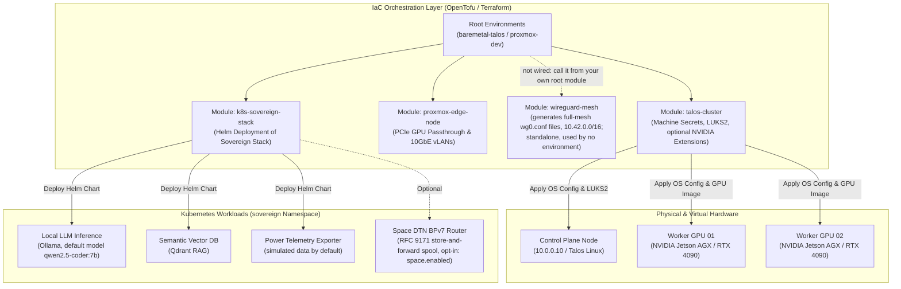

# 🏗️ Sovereign Mini Datacenter — Terraform & OpenTofu IaC

> **Infrastructure-as-Code (IaC)** for declarative, zero-cloud bare-metal and hypervisor provisioning of the **Sovereign Mini Datacenter (SMDC)** stack. Compatible with **OpenTofu ($\ge 1.7$)** and **Terraform ($\ge 1.6$)**.

---

## 1. Architectural Overview

The Terraform/OpenTofu modules provision infrastructure without a public cloud provider (AWS, GCP, Azure). The `baremetal-talos` environment configures Talos Linux on nodes that are already booted in maintenance mode, bootstraps Kubernetes and deploys the Helm chart; cluster add-ons (storage provisioner, ingress controller, NVIDIA device plugin) are prerequisites you install yourself (section 4). The `proxmox-dev` environment only creates the virtual machines. The `wireguard-mesh` and `libvirt-edge-node` modules are standalone: neither environment instantiates them.



---

## 2. Directory Structure

```
terraform/
├── README.md                           # This guide & architectural specification
├── versions.tf                         # Root provider versions & OpenTofu constraints
├── modules/
│   ├── talos-cluster/                  # Bare-metal Talos Linux OS & K8s bootstrapping
│   │   ├── main.tf                     # Talos secrets, machine configs, and kubeconfig
│   │   ├── variables.tf                # Cluster nodes, disks, network & LUKS options
│   │   ├── outputs.tf                  # Generated kubeconfig, talosconfig, and IPs
│   │   └── versions.tf
│   ├── proxmox-edge-node/              # Proxmox VE VM provisioning with PCIe passthrough
│   │   ├── main.tf                     # VM resources, virtio SCSI disks, GPU passthrough
│   │   ├── variables.tf                # CPU cores, RAM, datastore, PCI ID / resource mapping
│   │   ├── outputs.tf                  # VM IDs, MAC addresses
│   │   └── versions.tf
│   ├── libvirt-edge-node/              # Local KVM / Libvirt development VM (standalone)
│   │   ├── main.tf                     # Libvirt domain & qcow2 volume resources
│   │   ├── variables.tf                # vCPU, memory, storage pool options
│   │   ├── outputs.tf                  # Domain IDs and DHCP leases
│   │   └── versions.tf
│   ├── wireguard-mesh/                 # Full-mesh WireGuard configuration generator (standalone)
│   │   ├── main.tf                     # Keypair generation and mesh configuration logic
│   │   ├── variables.tf                # Subnet (10.42.0.0/16), node endpoints & ports
│   │   ├── outputs.tf                  # Config files per node & public key map
│   │   ├── templates/wg.conf.tpl       # WireGuard configuration template
│   │   └── versions.tf
│   └── k8s-sovereign-stack/            # Helm deployment of kubernetes/helm/sovereign-stack
│       ├── main.tf                     # Helm release binding for AI, telemetry & DTN
│       ├── variables.tf                # Namespace, StorageClass, ingress, GPU, AI model
│       ├── outputs.tf                  # Helm release status and namespace
│       └── versions.tf
└── environments/
    ├── baremetal-talos/                # Bare-metal 3-node cluster deployment
    │   ├── main.tf                     # Integrates talos-cluster and k8s-sovereign-stack
    │   ├── variables.tf
    │   ├── terraform.tfvars.example    # Sample IPs, NIC names, install disks, prerequisites
    │   ├── outputs.tf
    │   └── versions.tf
    └── proxmox-dev/                    # Virtualized Proxmox VE testbed deployment
        ├── main.tf                     # Spawns virtual control plane and GPU worker VMs
        ├── variables.tf
        ├── terraform.tfvars.example    # Proxmox API token and node credentials
        ├── outputs.tf
        └── versions.tf
```

---

## 3. Module Index & Capabilities

| Module | Target | Key Features |
| :--- | :--- | :--- |
| **`talos-cluster`** | Bare-metal compute nodes | LUKS2 disk encryption, optional static addressing per node (`interface` + `network_prefix_length` + `gateway`; no bonding), optional NVIDIA drivers for GPU workers via a Talos Image Factory installer image (`gpu_installer_image`) or explicit extension image references (`gpu_extension_images`), Talos API bootstrap and kubeconfig export. |
| **`proxmox-edge-node`** | Proxmox VE hypervisors | Automated VM creation, PCIe GPU passthrough on the `q35` machine type (by PCI resource mapping `gpu_mapping`, or raw PCI id for `root@pam` password auth only), SCSI SSD storage with TRIM/discard, optional QEMU guest agent (off by default; stock Talos has none). |
| **`libvirt-edge-node`** | Local Linux / KVM | Headless edge VM testbeds with host-passthrough CPU (dmacvicar/libvirt `0.8.x`). Needs `base_image_path` pointing at a bootable disk image; without it the VM has a blank disk and no boot media. |
| **`wireguard-mesh`** | Multi-node edge mesh | Asymmetric key generation, one preshared key per node pair, `wg0.conf` generation for a full mesh inside `mesh_subnet` (`10.42.0.0/16`). Each peer is routed only its own `/32` plus explicitly listed extra CIDRs. The module only generates keys and configuration text (sensitive output `node_configs`): it installs nothing on the nodes, and no environment in this directory calls it. |
| **`k8s-sovereign-stack`** | Kubernetes ($\ge 1.30$) | Deploys [`kubernetes/helm/sovereign-stack`](../kubernetes/helm/sovereign-stack) (Ollama, Qdrant, core services, telemetry) and exposes `storage_class`, `ingress_enabled`, `ingress_class_name`, `enable_gpu`, `gpu_runtime_class_name`, `simulate_telemetry` and `telemetry_bridge_url`. Installs no cluster add-ons; see the prerequisites below. Telemetry is simulated by default (`simulate_telemetry = true`): in hardware mode (`false`) the exporter re-exports the ESP32 telemetry bridge at `telemetry_bridge_url` (rendered as `ESP32_BRIDGE_URL`); with no bridge URL it reports no telemetry source and no measurements. The exporter runs the chart's bundled script in the stock `python:3.11-alpine` image, so the release (installed with `wait = true`) pulls no project-built image; a prebuilt exporter image can be selected through `custom_values` (`telemetry.powerExporter.image.repository`). |

---

## 4. Quickstart Guide

### Prerequisites
- **OpenTofu** ($\ge 1.7.0$) or **Terraform** ($\ge 1.6.0$) installed:
  ```bash
  tofu version
  ```
- **`talosctl`** CLI installed for interacting with Talos Linux nodes.
- **`kubectl`** and **`helm`** CLI tools.

### Cluster prerequisites (not installed by this IaC)

> **Read this before `tofu apply`.** The `talos-cluster` module produces a bare Kubernetes cluster. The Helm chart deployed by `k8s-sovereign-stack` needs cluster add-ons that **no module in this directory installs**:

| Prerequisite | Needed for | Variable | If it is missing |
| :--- | :--- | :--- | :--- |
| StorageClass backed by a dynamic provisioner | every PersistentVolumeClaim | `storage_class` | PVCs stay `Pending`; the Helm release times out |
| Ingress controller | the Ingress for the web UIs | `ingress_enabled`, `ingress_class_name` | the Ingress is never served; keep `ingress_enabled = false` |
| NVIDIA drivers on GPU workers (Talos Image Factory image), NVIDIA device plugin and usually an `nvidia` RuntimeClass | `nvidia.com/gpu` for Ollama | `gpu_installer_image`, `enable_gpu`, `gpu_runtime_class_name` | the Ollama pod stays `Pending`; keep `enable_gpu = false` (CPU inference) |

k3s ships a `local-path` StorageClass and Traefik, which is why the chart defaults to them; Talos ships neither. In `environments/baremetal-talos`, `storage_class` therefore has no default, and ingress and GPU are off until you enable them.

The NVIDIA extension images are deliberately not hard-coded: their tags are not the Talos version. Generate an installer image (or look up the exact extension references) for your Talos release at [Talos Image Factory](https://factory.talos.dev).

---

### Option A — Deploy Bare-Metal Talos Cluster & Sovereign Stack

1. **Navigate to the Bare-Metal Environment**:
   ```bash
   cd terraform/environments/baremetal-talos
   ```

2. **Configure Node Hardware Settings**:
   ```bash
   cp terraform.tfvars.example terraform.tfvars
   # Edit IP addresses, NIC names, NVMe install disks and hostnames to match the physical rack,
   # and set storage_class (see "Cluster prerequisites")
   ```
   Each node must already answer on its `ip` in Talos maintenance mode (for example through a DHCP reservation). Setting `interface` then pins that address statically; leaving it unset keeps the node on DHCP.

3. **Initialize and Apply in Two Stages**:
   ```bash
   tofu init

   # Stage 1: bring up the Talos cluster only
   tofu apply -target=module.talos

   # Install the prerequisites on the new cluster (storage provisioner, and
   # optionally an ingress controller and the NVIDIA device plugin)
   export KUBECONFIG="$(pwd)/_output/kubeconfig"

   # Stage 2: deploy the sovereign stack
   tofu plan -out=tfplan
   tofu apply tfplan
   ```
   A single-pass apply cannot converge on a fresh cluster, because the Helm release waits for PersistentVolumeClaims that only bind once a storage provisioner exists.

4. **Verify Deployment & Connect**:
   The module automatically saves the cluster credentials into `./_output/`:
   ```bash
   export KUBECONFIG="$(pwd)/_output/kubeconfig"
   export TALOSCONFIG="$(pwd)/_output/talosconfig"

   # Check Talos node health
   talosctl --talosconfig=$TALOSCONFIG -n 10.0.0.10 health

   # Inspect Kubernetes pods
   kubectl get pods -n sovereign -o wide
   ```

---

### Option B — Deploy Virtualized Proxmox VE Testbed

1. **Navigate to the Proxmox Environment**:
   ```bash
   cd terraform/environments/proxmox-dev
   ```

2. **Set Proxmox API Credentials**:
   ```bash
   cp terraform.tfvars.example terraform.tfvars
   # Set proxmox_endpoint, proxmox_api_token, target_node and gpu_mapping
   ```
   The GPU worker uses PCIe passthrough through a Proxmox **PCI resource mapping** (`gpu_mapping`, created under Datacenter > Resource Mappings), because Proxmox does not let API tokens attach a raw PCI id. TLS verification of the Proxmox API is on by default (`proxmox_insecure = false`).

3. **Apply Virtual Infrastructure**:
   ```bash
   tofu init
   tofu apply -auto-approve
   ```

---

## 5. Security Properties

- **At-Rest Encryption**: With `enable_luks_encryption = true` the `talos-cluster` module encrypts the Talos STATE and EPHEMERAL partitions of the install disk with **LUKS2**, using a key derived from the node's hardware UUID (`nodeID`). This protects data on a disk that is removed from its node (disposal, RMA, a stolen drive). It does **not** protect against theft of the whole node, which unlocks itself at boot, and the node UUID is not a secret. For that threat model switch the key to a TPM-sealed or KMS-backed key in the machine config.
- **API-only node management (a Talos Linux property)**: Talos nodes run no SSH daemon, offer no shell and have an immutable root filesystem; they are managed through the Talos API (`talosctl`) over mutual TLS. The module generates the machine secrets and writes `talosconfig` and `kubeconfig` to `./_output/`: protect those files and the Terraform state, which contains the same secrets. This is not a zero-trust architecture; no per-request policy enforcement is configured.
- **Mesh cryptography (`wireguard-mesh`, standalone)**: the generated configurations give every node its own key pair and every pair of nodes its own preshared key, on top of standard WireGuard (Curve25519, ChaCha20-Poly1305). A preshared key is WireGuard's documented hedge against a future quantum attack on the key exchange, but this is not post-quantum cryptography and the modules contain no post-quantum packet wrapper. The keys are stored in the Terraform state.
